# Unity 自动战斗原型（AutoBattle）

一个用 Unity 做的挂机自动战斗小游戏。核心循环是：主角自动打怪 → 掉落装备 → 自动换装 → 升级加点 → 打更强的关。全部数值都在编辑器里可调、可热改，并有一整套平衡回归工具保证改数值不会悄悄跑偏。

项目的特殊之处在于：**它不是手写出来的，而是由 AI 编码代理（DeepSeek Harness）驱动 Unity 编辑器逐步搭建的**。开发过程留在了仓库里（`.mnemon/`），包括每一步的设计理由、踩过的坑和平衡实验数据。


## 玩法

- **自动战斗**：主角与怪物按各自的攻击间隔自动互殴，伤害公式为 `攻击 × 攻速 × (1 + 暴击率 × (暴击倍率 − 1))`，防御按 `护甲 / (护甲 + 系数 × 等级)` 减伤。
- **五槽装备**：武器 / 衣服 / 头盔 / 鞋 / 饰品五个槽位；头盔通关 3-10、鞋 6-10、饰品 11-10 后解锁，解锁时送一件同等级稀有起步件。小件只带 2 条副词条、数值按 50%，且副词条池不出暴击率，避免五槽完美装把暴击率堆到溢出。
- **装备掉落与自动换装**：掉落基础概率 30%，每多一个已解锁槽位 +5%（五槽 45%）；30% 的掉落会优先补空槽或评分最低的槽。按「增量期望 DPS + 有效生命/8」评分，高于同槽当前件就自动穿上，否则卖掉换金币。
- **手动换装与锁定**：关掉设置里的「自动换装」，或把当前装备锁住后，更强的掉落会进「待选」（每个槽位只留最高分的一件，不进存档，换装/卖出/换档/读档即清空）。点左上「对比」或直接点某张装备卡开对比面板：顶部五个槽位页签，两栏列出当前件与待选件的主属性、词条、评分与 Δ，逐项差分成两行（主属性 / 词条）并标红绿；再决定换装、按等级与品质折价卖出，或锁定当前件。比当前差的掉落不会进待选，直接卖店。
- **设置与新手引导**：左上齿轮按钮（原「⚙ 设置」）可分别关掉伤害飘字、实时 DPS、装备评分、技能推荐分与自动换装，另有主音量 / 音效音量两组 10 格音量条与 ± 微调（实际音量 = 主音量 × 音效音量）——改动立刻生效；背景音乐音量在音符面板里单独调（同样与主音量相乘），存在本机 PlayerPrefs（与存档槽无关），也能一键恢复默认或重看引导。首次启动自动弹 6 步新手引导：全屏压暗、按步骤在目标控件上挖洞并描金边，会冻结战斗（避免在教程里被打死）；走完或跳过会记标记，之后不再自动弹。
- **音效与背景音乐**：14 个最小音效集（按钮点击、面板开合、普攻/暴击、金币/卖出、升级、成就、BOSS 出场、阵亡、强化、洗练、购买、药剂），命中音 45ms 节流；音频源 `ignoreListenerPause`，暂停面板里也能听见点击。BGM 是本地四首曲目（Let me go / 大肥鱼人是猫 (Remix) / 我会去拥抱他 / 我的悲伤是水做的（大肥鱼版）），顶部音符面板可自选、暂停/继续、上一首/下一首、列表循环或单曲循环，并单独调音乐音量；播放状态与上次曲目记在 PlayerPrefs。音效来自 Kenney 的 CC0 包，BGM 来自项目所有者的本地文件（不随仓库分发），逐条来源见 [docs/audio-credits.md](docs/audio-credits.md)。
- **技能推荐分**：`SkillAdvice` 按当前面板（攻击/攻速/暴击/生存）给每张技能卡打 0~100 分并分档（一般 / 好用 / 很强），三选一与技能池里最高分的卡带金色 ★ 与金色强调条。分数只用来排序，不参与战斗结算；不需要时可在设置里关掉。
- **强化与洗练**：强化（+1~+15）只抬主属性，费用随等级与品质涨；洗练重抽**全部**副词条、条数不变（与掉落同一张分布），主属性与强化等级不动，费用按次数 `×(1 + 0.6n)` 递增。洗练不抬高任何一条词条的天花板，只是用金币把「等一件好词条」的方差换掉——这也是终局金币的第一个出口。词条行可以点着锁住，锁住的那条不重抽，费用按 `3^锁条数` 加价（锁 1 条 ×3、锁 3 条 ×27）：锁得越多单次越贵，但追一条好词条的总花费反而可能更低，买的是确定性不是上限。设计与验收清单见 [docs/equipment-reforge.md](docs/equipment-reforge.md)。
- **技能三选一**：满级后每 10 级巅峰发一次，从随机三个候选里选一个装进技能槽（共 6 槽）。平衡探针会用 `ProbePolicy` 对每个候选实打三种关底 BOSS 后按胜场/剩余血量择优；游戏内仍由玩家自己选。
- **关卡制**：11 章 × 10 关，第 N 章怪物 Lv.10(N−1)+1 ~ 10N（1-1 是 Lv.1 小鸡，11-10 是 Lv.110 BOSS），每关击杀 3~6 只，最后一只为关底精英或 BOSS。怪物等级不跟着主角走；怪物经验随等级线性抬高（`GameConfig.ChapterExpFactor`），保证主角等级能跟上章节。
- **巅峰等级**：满级后继续攒经验换巅峰等级，每级 +1 攻 / +1 防 / +50 生命，每 10 级发一张技能卡（共 15 张，槽位 6 个，多出来的要自己取舍）。巅峰经验 = `2000 + 200p + 20p²`（P0→P200 累计 5,731 万，P0→P1000 累计约 67.5 亿）；P0→P200 纯战斗约 1.0 小时、含刷怪与商店约 2.7 小时（2026-10-21 五槽实测 62.2 / 164.8 分钟），P0→P200 即可通关第 11 章（终局墙按 P60 左右设计）；P0→P1000 约 301 小时（1× 连续，约 12.5 天；4× 约 75 小时），是给长期玩家的沙盒目标，不是通关必需。
- **阵亡 = 回去刷小怪**：阵亡不给经验，只把本关击杀数清零。想变强就回去刷本关小怪（经验只从活着的怪身上拿），再回来打精英 / 关底——打小怪 → 打精英/BOSS → 阵亡 → 回头刷小怪 → 再打。
- **关底是连续的消耗链**：精英战前不回血（血量从上一只怪一路带过来），只有关底 BOSS 战前回满。11-10 的终局 BOSS 按挑战次数轮换类型（近战 → 远程 → 暴击怪），不再靠掷骰决定难度。
- **多存档槽**：3 个互不影响的存档，进度、金币、装备、技能各自独立。
- **无尽模式**：首通 11-10 或已经转生过即可解锁（满级 100 才能进）。每清完一层立刻进下一层，每 5 层一个 BOSS；怪物等级 `110 + (层-1) × 6`，HP/攻/防再乘 2.8。死亡或撤退结束本局，最高层只记「已清除」的层，分本档与全局两个记录；再次挑战从 `max(1, 本档最高 − 4)` 开始，也可从第 1 层重来。层通过发金币、新纪录额外发首通金币，击杀不发金币；掉落与经验等级封顶 150，避免高层装备膨胀。五槽版本下，P1000 + Lv150 满倍率满词条（50 种子；2026-10-20 用 400 层上限重跑）首死中位第 290 层（P10 272 / P90 305 / max 320，无局打满；旧的 300 层封顶口径为 P10 273 / P90 296 / max 300，22 局打满）；随机五槽词条（3 种子）中位约 242 层。理想配装的实测中位已高于设计目标 235~250，随机配装仍在目标附近，是否收紧见「已知问题」。详细设计与基线见 [docs/endless-mode.md](docs/endless-mode.md)。
- **转生（轮回）**：通关 11-10、满级且巅峰达到 100 后，在存档面板进入轮回。印记按本世巅峰（每 100 级 1 枚，上限 10）、无尽最高（每 50 层 1 枚，上限 5）、金币（每 10 万起按 2 的幂，上限 14）折算，另加基础 1 枚；印记购买五条永久升级（战斗 +1%/级、经验与金币各 +20%/级、掉落 +2%/级、起始等级 +2/级、起始金币 500/药剂 1 每级）。转生重置等级、巅峰、金币、关卡、五槽装备、技能与本世累计统计，保留印记余额、五条永久升级、成就累计与解锁、无尽最高层与全局纪录。每世都要重打 11-10；转生后本世未重通 11-10 时只能从第 1 层开始，重通后恢复检查点，且等级 100 才能再进无尽。设计与实现记录见 [docs/rebirth.md](docs/rebirth.md)。
- **成就**：42 条成就、合计 805 成就点与 7 个称号，按存档槽独立累计；左栏「成就」入口打开面板，可按 6 类筛选、只看未完成、分页查看，打开时冻结战斗。解锁在右侧弹一条 2.5 秒 toast（多条排队；任一模态或通关横幅可见时隐藏，恢复后续播），旧档按可证明状态静默补发、不补金币。成就只给成就点、称号与一次性金币，不加战斗属性；「无阵亡通关」要求在第 9/10/11 章从第 1 关连续打完第 10 关。设计与实现记录见 [docs/achievements.md](docs/achievements.md)。

| 技能三选一 | 关卡选择 |
|---|---|
|  |  |

| 战斗可读性（飘字 / DPS / 状态栏） | 技能面板 |
|---|---|
|  |  |

| 洗练面板 | 洗练日志（最新在上） |
|---|---|
| 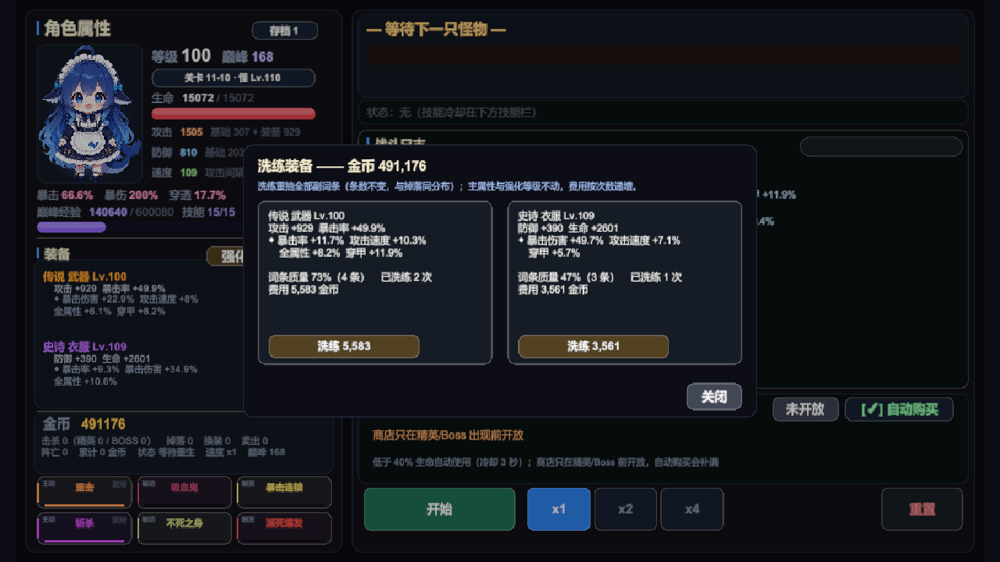 | 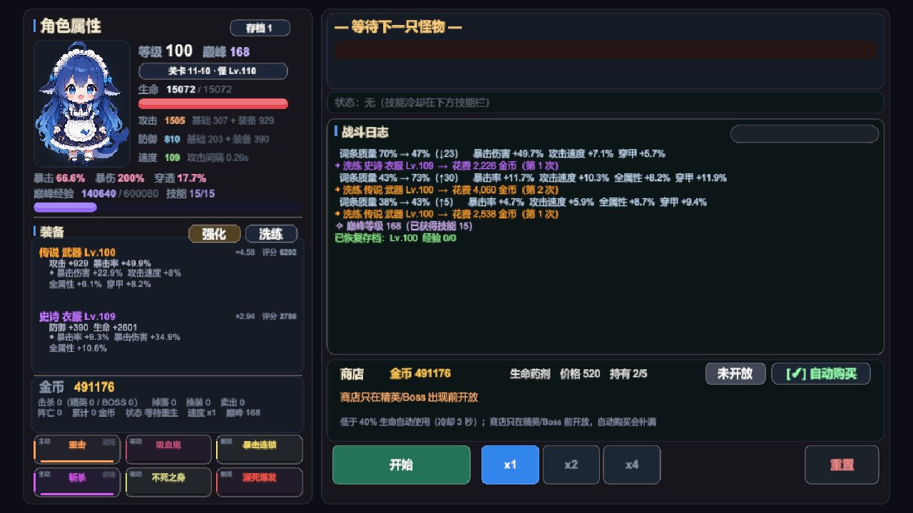 |

| 锁 3 条（费用 ×27） | 全锁态 |
|---|---|
| 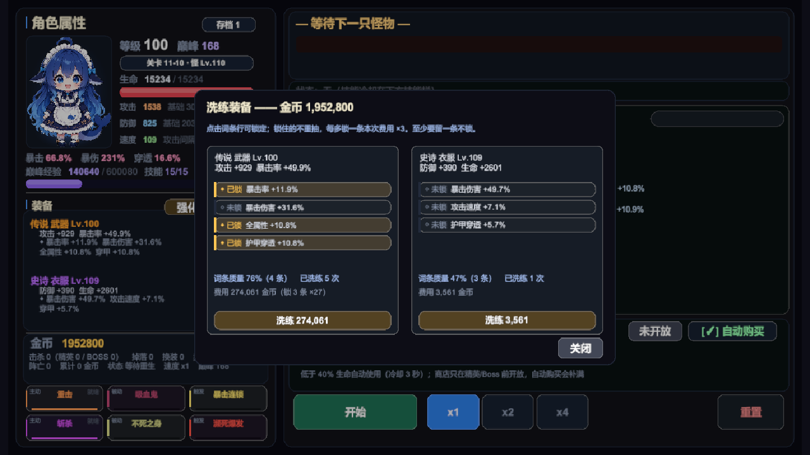 | 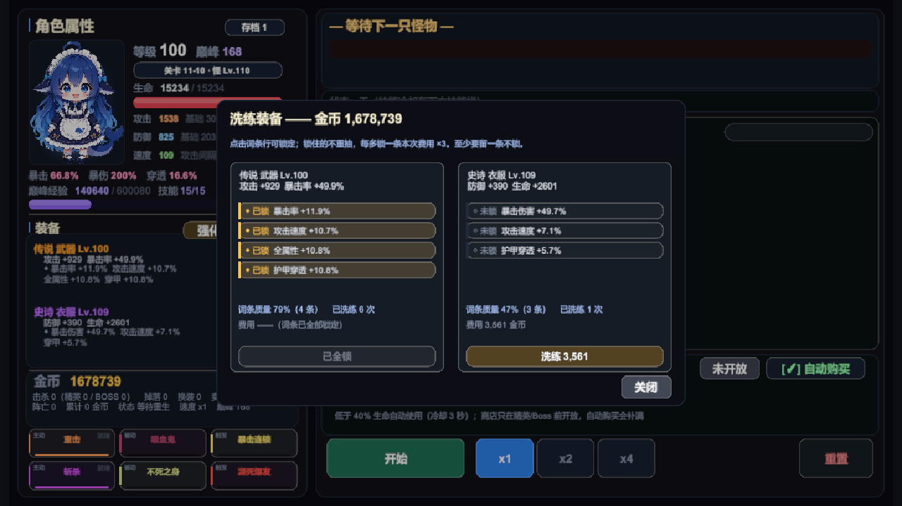 |

| 设置面板（含主音量 / 音效音量） | 装备对比（弱于当前件时红字提示） |
|---|---|
|  | 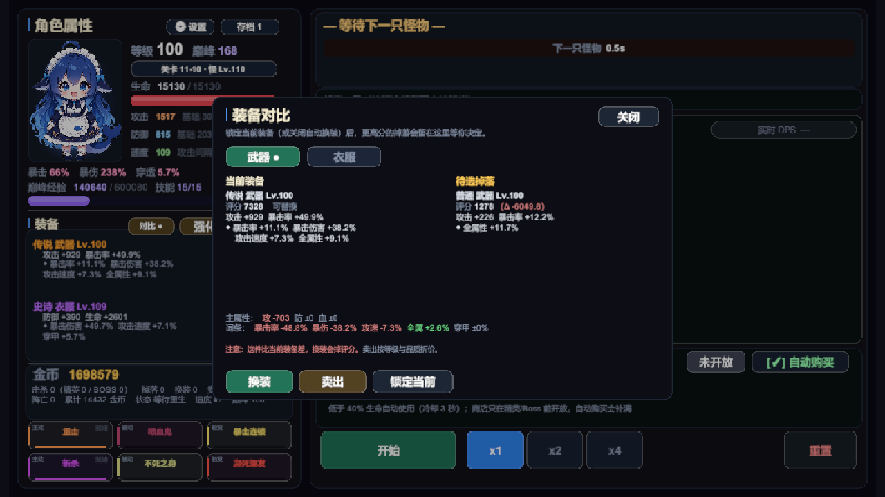 |

| 背景音乐（四首 / 自选 / 循环 / 音量） | 主界面顶部音符入口 |
|---|---|
|  |  |

| 五槽装备（2×3 卡） | 五槽对比（顶部五个页签） |
|---|---|
|  |  |

| 新手引导（在技能栏上挖洞） | 技能推荐分 |
|---|---|
| 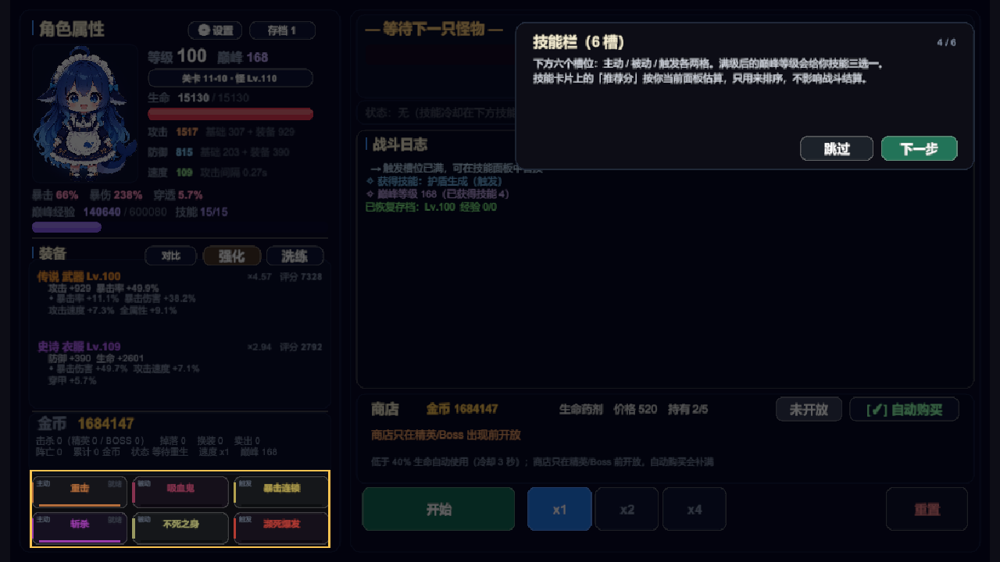 | 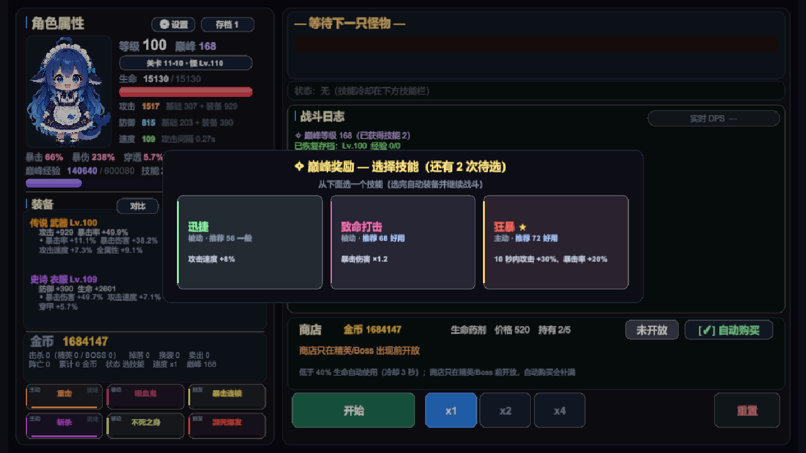 |

| 无尽模式面板 | 无尽结算（阵亡 / 最高层） |
|---|---|
|  |  |

| P1000 面板（巅峰已达上限） | P1000 无尽 215 层 |
|---|---|
| 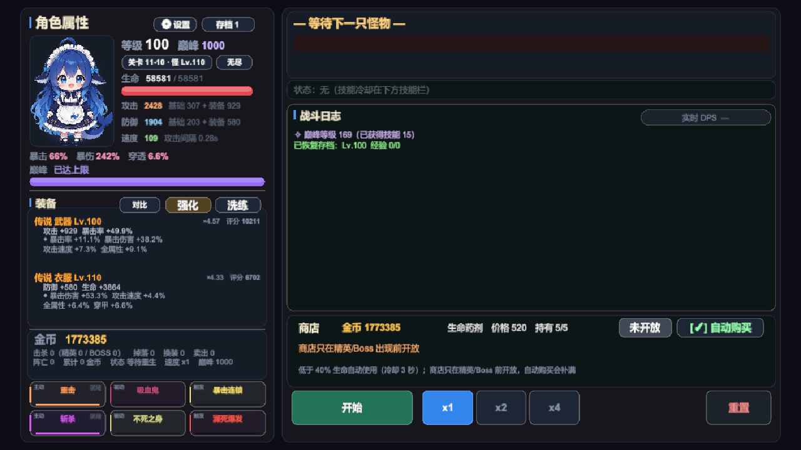 | 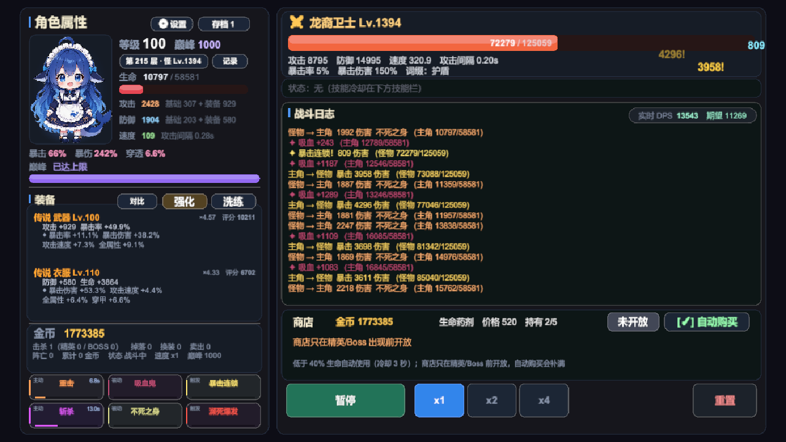 |

| 轮回入口（存档面板） | 轮回面板（五条永久升级） |
|---|---|
| 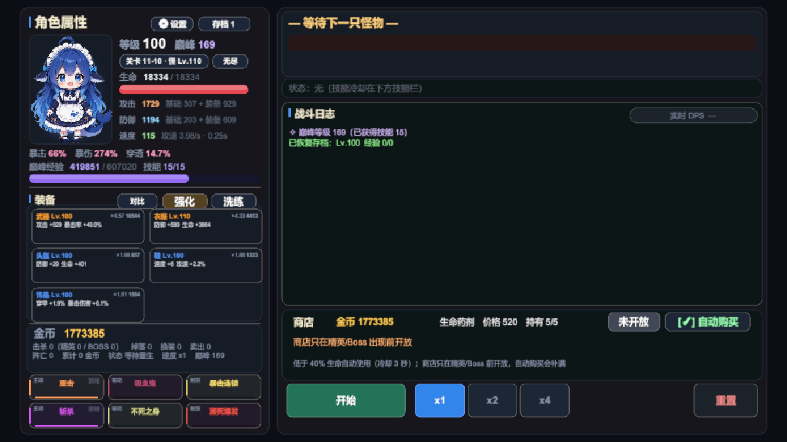 | 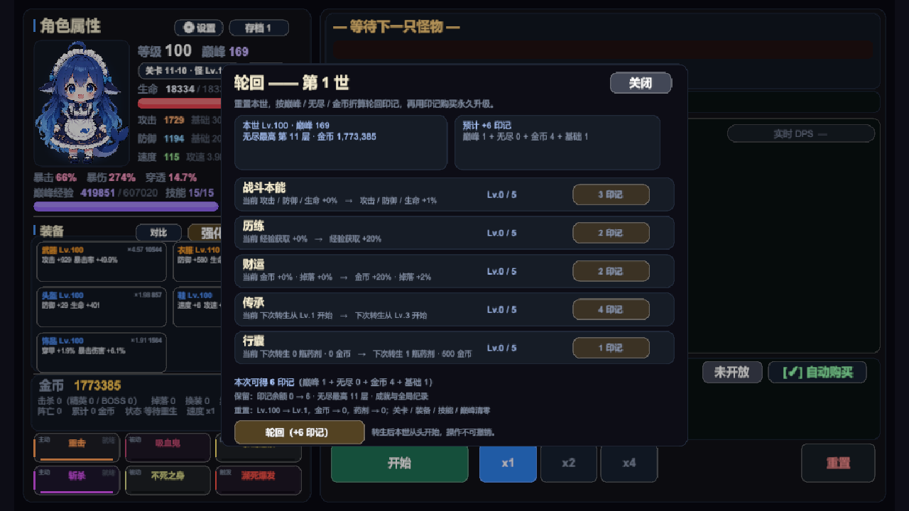 |

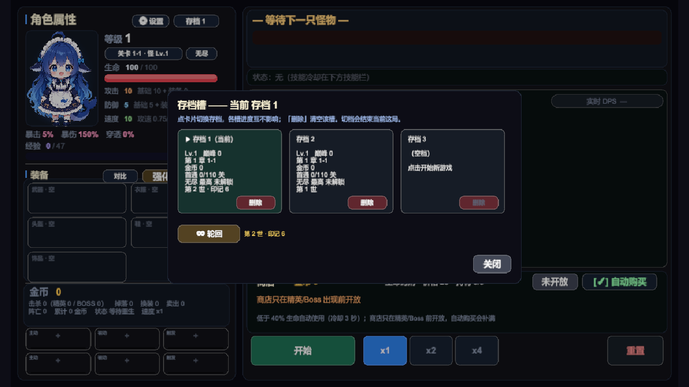

| 成就面板（分类 / 分页 / 进度） | 解锁 toast（右侧，不挡操作） |
|---|---|
| 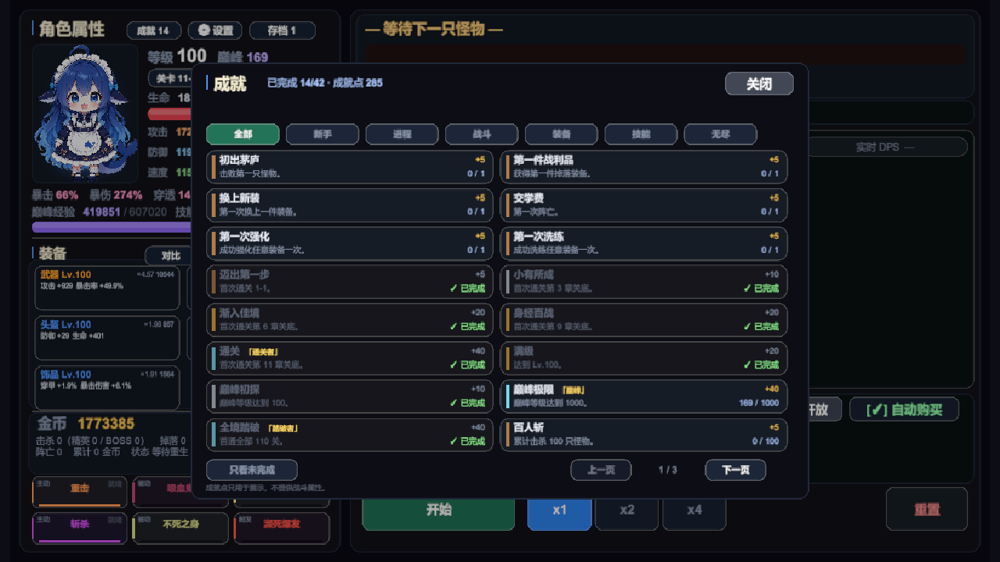 |  |

| 多形状按钮（开始 / 重置 / 速度 / 装备入口） | 战斗态（怪物卡 / 暂停图标 / 技能冷却） |
|---|---|
|  |  |

| 立绘待机（呼吸 / 轻微摆动） | 眨眼帧 |
|---|---|
| 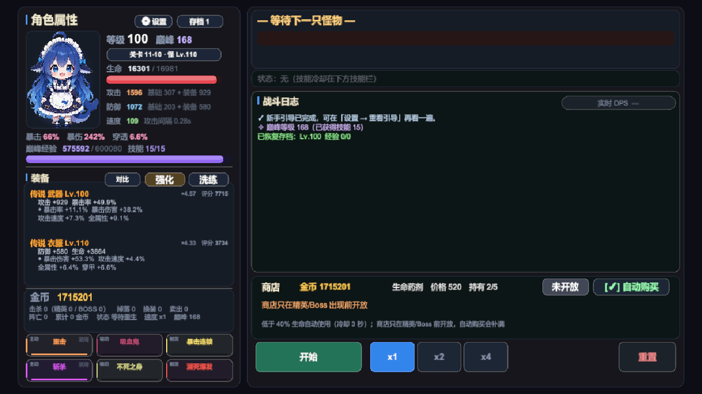 |  |

## 界面

界面全部由代码搭建（`GameUI` 主文件 + 十二个 partial，共十三个文件：构建 / 浮层 / 刷新核心 / 主题工具 / 装备对比 / 设置与引导 / 音乐 / 立绘待机 / 无尽模式 / 转生 / 成就 / 图标 / 按钮底板），没有 prefab。美术资源只有主角立绘、`Resources/Icons` 下 85 个透明 PNG、`Resources/Sfx` 下 14 个 OGG 音效（Kenney CC0），以及 `Resources/Music` 下四首本地 MP3。图标包括 36 个 256×256 圆形徽章（功能入口、技能、属性）、16 个命令 glyph（播放 / 暂停 / 重置 / 关闭 / 购买 / 换装 / 卖出 / 锁定等）、17 个功能 glyph（含音乐音符）、16 张深海军蓝珐琅底框（长条 / 缺口长条 / 方形 / 八角 / 六边 / 盾形 / 丝带 / 药丸 / 椭圆 / 页签 / 横幅等）。功能入口是 44×44 / 40×40 / 34×34 的图标徽章，成就数、存档号做成右下角深色数字；命令按钮换成长条/方形/六边形底框 + 金色 glyph + 名称，开始/暂停、关闭、换装、卖出、购买、强化、洗练、页签共用同一套；音效由 `GameAudio.cs` 播放，BGM 由 `GameMusic.cs` 播放。紧凑入口没有文字，鼠标悬停显示名称（点下后立即收起）；速度按钮是图标在上、×1/×2/×4 在下的竖向排布。图标由 Seedream 生图、去白底、按圆或形状切图后导入为 Single Sprite。参考分辨率 1280×720，CanvasScaler 用 Expand，所有面板挂在居中的 `ContentRoot`（1280×720）上——窗口比例不对时内容居中、两侧留白，而不是被拉伸变形。

- **左栏**：主角立绘（`Resources/HeroPortrait.png`，140×179 卡片，垫一层冷色背光 + 脚下一滩地灯，否则深色立绘会陷进同样深的面板底；带呼吸、轻微浮动/摇摆和随机眨眼，眨眼帧是同图只闭眼的 `HeroPortraitBlink.png`，整体变换不重绘角色）→ 属性列贴到立绘右侧（等级 / 巅峰 / 关卡 / 生命条 / 攻防速；速度行同时写出有效攻速与攻击间隔），暴击与巅峰经验走整幅宽行 → 装备（2 列 × 3 行、共五张紧凑卡，每卡显示品质色标题/等级、主属性，右上角「倍率 · 评分」；点卡直接打开该槽位的对比）→ 金币与战绩统计 → 6 格技能栏（3 列 × 2 行，主动 / 被动 / 触发各两格，空槽是 `＋`）。
- **右栏**：怪物卡（名字等级、血条、属性行、状态行；空场时血槽走 `RowBg` 并显示「下一只怪物 N.Ns」）、战斗日志（`实时 DPS` 挂在标题右侧）、商店、操作按钮。

配色语言在 `GameConfig.Colors.cs`：

- 底色分四级——`PanelBg` 面板、`CardBg` 卡片、`RowBg` 行、`CardBgDim` 空槽，靠明度差分层，不堆描边。
- 文字分四档——`TextTitle` 标题、`TextNormal` 正文、`TextMuted` 注释、`TextDisabled` 占位。
- **技能色只染 5% 卡底 + 左侧 3px 强调条**，名字保留本色。工程是 Linear 色彩空间，脚本里的线性值转 sRGB 会被提亮，所以染色比例必须压得很低：12% 上屏就已经像调色板。
- 按钮底板与悬停提示集中在 `GameUI.Buttons.cs`：`StyleIcon` 是纯图标/角标（顶部与装备入口），`StyleBar` 是图标在左、名称在右（开始/暂停、关闭、换装、购买、强化、洗练），`StyleStack` 是图标在上、短名称在下（速度 ×1/×2/×4），`StyleTab` 只换底框、保留文字（章节/成就分类）；图标按钮挂 `UITooltipTrigger`，悬停显示名称，点下立即收起。
- 浮层统一 `OverlayBg` + 圆角 + 1px 边，打开时全屏压一层 55% 黑（`ModalDim`）。所有浮层（选关 / 技能 / 强化 / 洗练 / 存档 / 设置 / 音乐 / 对比 / 无尽 / 轮回 / 成就 / 引导）**互斥**，任一浮层打开时其余都会关闭；三选一没选完时其余浮层一律拒绝打开（否则候选卡会叠在浮层上面）。装备标题行右侧并排三枚 40×40 图标按钮（天平 / 铁砧 / 蓝火），分别打开对比 / 强化 / 洗练；强化与洗练面板同构：顶部五个槽位标签 + 单张卡详情。洗练卡列主属性、副词条、`词条质量 73%（4 条）已洗练 2 次`、本次费用；金币不够时按钮压暗、费用行标「（不足）」，卡片内容仍按真实数值显示。卡里的词条行可点：`◆ 已锁` 的行不重抽、行首 3px 竖条转金色，费用行同步写「（锁 3 条 ×27）」；锁满时按钮压成「已全锁」，费用行改「费用 ——（词条已全部锁定）」。

设置面板 5 行开关（伤害飘字 / 实时 DPS / 装备评分 / 技能推荐分 / 自动换装）加一行重看引导，下面是主音量 / 音效音量两组 10 格音量条与 ± 微调，开关按钮右侧写清「关掉之后会发生什么」，底部是恢复默认与一条提示。背景音乐面板是 600×486 的独立浮层：四张曲目卡（当前曲高亮）、上一首 / 播放暂停 / 下一首 / 循环模式，下面是 10 格音乐音量与 ± 微调，底部说明列表循环与单曲循环的区别。装备对比面板与它们同构：顶部五个槽位页签，左栏当前件、右栏待选（含评分 Δ 与逐项差），底部换装 / 卖出 / 锁定三个动作；锁定时按钮变「解除锁定」、当前件标注 🔒 已锁定，天平图标在有待选时转金色。新手引导一层四块遮罩拼出洞口（四边各 1px 金边），洞口放一块几乎全透明的拦截层：被指到的控件自己可点，但点在别处不会顺手开出选关/技能面板；卡片按目标方位自动放到对角，第 1 步无目标时居中。成就面板是 808×560 的独立浮层：顶部 7 个页签（全部 + 6 类），下面 2 列 × 8 行，每行左侧 4px 级别色条、名称、描述、右侧进度/点数；完成行压暗并标 `✓ 已完成`，有称号的条目把金色称号接在名称行。底部「只看未完成」与上一页/页码/下一页，42 条分 3 页（16/16/10），打开时每 0.5 秒只刷新进度文本。解锁 toast 固定 600,430、500×56，排在通关横幅之上、所有浮层之下；任一模态或横幅可见时整条隐藏并暂停 2.5 秒计时，恢复后再续播。

飘字（伤害数字）的规则：只给「主角 → 怪物」的伤害飘字，怪物打主角看日志和左栏血条就够；普攻落在怪物血条右半段，非暴击按一半概率丢弃；暴击 19 号、普攻 14 号、技能 17 号；寿命 0.55 秒，三条纵向轨道轮流落点——攻速 0.27 秒时同屏 2~3 个数字，再密就糊成一片（早期版本 26 号字、1.15 秒，直接把日志盖住了）。

刷新分两层走：`Refresh()` 每帧只做**静态签名比对**——把该显示的字段塞进一个 `Sig` 结构，签名不变就不碰字符串、不改组件颜色；文本类（金币、冷却秒数、商店倒计时）按 0.1 秒节拍单独再走一遍。技能栏的冷却条是唯一每帧重绘的东西，还带 0.05 像素去抖。实测暂停时每秒约 1 次重建，x4 战斗约 8 次/秒；改造前是每帧无条件重建约 30 条字符串（连装备评分和 DPS 都每帧重算）。

日志写入只有一个实现：`BattleLog.Append`（私有）负责累计条数、裁剪与版本号，对外分 `AddSystem`（系统 / 进度 / 商店）与 `AddCombat`（战斗过程）两个频道——`GameController.AddLog` 走前者，`BattleSystem` 走后者。分频道不是为了计数，是为了以后按频道过滤、配色时有地方挂，也逼新写日志的人先回答「这条属于哪一类」。

## 运行

1. 用 **Unity 6000.6.5f1** 打开 `HelloWorldProject/`（Universal 2D 模板）。
2. 打开 `Assets/Scenes/SampleScene.unity`。
3. 点 Play。场景里只有一个 `Bootstrap`，它在 `Awake` 里依次 `AddComponent` 出 `GameAudio`、`GameMusic`、`GameController` 和 `GameUI`，界面全部由代码构建，**没有任何 prefab 依赖**。

## 项目结构

```
HelloWorldProject/Assets/
├── Scripts/                 运行时（43 个文件，约 15,781 行）
│   ├── Bootstrap.cs         入口：装配控制器与界面
│   ├── GameController.cs    主状态机 + 关卡推进 + 掉落结算 + 强化/洗练（1796 行）
│   ├── GameController.Endless.cs 无尽模式状态机：开局 / 清层 / BOSS / 结算（310 行）
│   ├── GameController.Rebirth.cs 转生：印记折算 / 购买 / 重置与结算（225 行）
│   ├── GameController.Achievements.cs 成就记账 / 无阵亡连续挑战 / 即时求值（163 行）
│   ├── GameUI.cs            UI 构建与左右面板（768 行）
│   ├── GameUI.Panels.cs     浮层面板：选关 / 技能 / 强化 / 洗练 / 存档（1,342 行）
│   ├── GameUI.Compare.cs    装备对比浮层：五槽页签 + 两栏差值 + 换装/卖出/锁定（322 行）
│   ├── GameUI.Settings.cs   设置面板、音量与新手引导（503 行）
│   ├── GameUI.Core.cs       刷新循环、控件工厂、飘字与 DPS（884 行）
│   ├── GameUI.Achievements.cs 成就入口 / 面板 / 分页筛选 / 解锁 toast（509 行）
│   ├── GameUI.Portrait.cs   立绘待机动画：呼吸 / 摆动 / 眨眼（153 行）
│   ├── GameUI.Endless.cs    无尽面板 / 结果面板 / HUD 分支（347 行）
│   ├── GameUI.Rebirth.cs    轮回入口 / 面板 / 二次确认（270 行）
│   ├── GameUI.Theme.cs      主题工具：圆角图 / 卡片 / 分区标题（218 行）
│   ├── GameUI.Icons.cs      图标加载与接线：图标按钮 / 分区标题 / 技能卡 / 装备槽（178 行）
│   ├── GameUI.Buttons.cs    按钮底板 / 图标+名称排版 / 页签 / 悬停提示（265 行）
│   ├── GameUI.Music.cs      背景音乐入口与面板：曲目 / 播放控制 / 循环 / 音量（288 行）
│   ├── GameSettings.cs      PlayerPrefs 设置项、音量与引导标记（189 行）
│   ├── GameAudio.cs         音效播放：16 路音源、音量乘积、事件钩子（122 行）
│   ├── GameMusic.cs         背景音乐：四首曲目 / 循环 / 音量 / 状态持久化（284 行）
│   ├── SkillAdvice.cs       技能推荐分：按当前面板打分与分档（174 行）
│   ├── AchievementCatalog.cs 成就目录：42 条定义 / 6 类 / 点数与称号（185 行）
│   ├── AchievementSystem.cs 成就求值：指标读取、Live 解锁、旧档静默补发（306 行）
│   ├── BattleLog.cs         日志唯一写入点（AddSystem / AddCombat 两个频道）
│   ├── BattleSystem.cs      战斗结算与技能效果
│   ├── Endless.cs           无尽层目录：层定义 / 怪物等级 / 击杀目标 / 记录（180 行）
│   ├── Models.cs            数据模型：MonsterData / Equipment / StageDef（772 行）
│   ├── Models.PlayerData.cs PlayerData：等级、关卡进度、五槽装备、技能槽、转生与存档字段（714 行）
│   ├── Models.Achievements.cs 成就定义 / 状态 / 目录数据模型（59 行）
│   ├── Models.PlayerStats.cs 跨世累计统计：击杀 / 掉落 / 强化 / 无阵亡掩码（34 行）
│   ├── Skills.cs            技能目录（15 个技能）
│   ├── SkillCatalog.Loader.cs 技能表的外部 JSON 加载与导出
│   ├── LootSystem.cs        掉落与词条随机
│   ├── EquipmentScore.cs    装备评分：增量期望 DPS
│   ├── Stages.cs            关卡目录与首通奖励公式
│   ├── SaveSystem.cs        存档（PlayerPrefs，当前 v10，按版本号迁移；715 行）
│   ├── RebirthCatalog.cs    转生目录：五条升级 / 费用 / 印记公式（131 行）
│   └── GameConfig*.cs       配置层：标量可热改，表结构需重编译
├── Editor/                  编辑器工具（9 个文件，约 4,344 行）
│   ├── LateGameProbe.cs     平衡实验集合（胜率表、技能 / 连携 / 生存审计）
│   ├── BalanceRegression.cs 平衡回归：静态哨兵（含新档过渡轨迹）+ 胜率表
│   ├── NewGameProgression.cs 新档进度探针：Lv.1 空身从 1-1 打到终点
│   ├── EndgamePacing.cs     终局节奏探针：满级之后要磨多久
│   ├── EndlessPacing.cs     无尽节奏探针：首死层数 / 单层耗时 / 50 层经济
│   ├── ProbePolicy.cs       探针的「玩家决策」：技能三选一打分 + 强化 + 洗练
│   ├── AchievementRegression.cs 成就 §11 回归：42 条指标 / 迁移 / 探针（1,070 行）
│   ├── SkillTableVerify.cs  skills.json 与代码表的对照自检
│   └── GameConfigReloader.cs 菜单：重读 game_config.json
├── Resources/
│   ├── game_config.json     可热改的标量配置（缺键会在加载时打警告）
│   ├── skills.json          15 个技能的数值表
│   ├── achievements.json    42 条成就定义（ID / 类别 / 指标 / 目标 / 点数 / 金币 / 称号）
│   ├── Icons/               85 个按钮底框 / glyph / 徽章图标（透明 PNG）
│   ├── Sfx/                 14 个 Kenney CC0 音效（OGG）
│   ├── Music/               四首本地 BGM（MP3，已 gitignore，不随仓库分发）
│   └── HeroPortrait*.png    主角立绘
├── Screenshots/             开发过程截图（README 引用的那几张）
└── Scenes/SampleScene.unity
```

仓库根目录还有几个不属于 Unity 工程的资产：

- `_balance/` —— 平衡回归基线（`baseline.json`）、探针说明（`README.md`）与冒烟截图（`shots/`），放在工程外以免被 Unity 导入。
- `_art/` —— 立绘素材、生成提示词与图像处理脚本。
- `docs/` —— 玩法设计与实现记录（装备洗练、无尽、转生、成就、音频来源等），README 里有对应链接。
- `.mnemon/` —— 项目知识库与热记忆，跨会话接手时从这里读。
- `_archive/` —— 归档区（已 gitignore）：`legacy/` 是拆分前的旧版 `GameController.cs`/`GameUI.cs` 与文件头备份，`screenshots/` 是早期开发截图。不进 Unity 工程，也不会被导入。
- `dsh-image-gen/` —— 生图插件的输出目录（已 gitignore）。

## 配置热改

`Assets/Resources/game_config.json` 里的**标量**（数值系数、倍率、开关）在编辑器里保存后会触发重载，Play 中立即生效，不需要重编译；打包后只在启动时加载一次。`GameConfig.Tables.cs` 里的**数组表**（技能表、章节怪物名、属性偏向等）是编译期常量，改 JSON 无效。两处的边界在 `GameConfig.Tables.cs` 头部有注释说明。

## 平衡回归

改数值之后跑一遍，能立刻看出是否把某档平衡打歪了：

- 菜单 **Tools/平衡回归/** → 静态哨兵（技能表、公式采样、关卡表、怪物样本、评分自洽性，外加新档过渡轨迹，约 1.2 秒；前五张表逐字符比对，过渡轨迹按容差比对）
- 胜率表（8 个巅峰档 × 4 个难度格，约 25 秒，容差 0.5 个百分点）

设计要点：战斗随机全部走 `UnityEngine.Random`，用 `Random.InitState` 固定种子让整轮模拟逐位可复现；每个巅峰档用独立种子，这样改动能定位到具体某一档。基线存在 `_balance/baseline.json`。

`NewGameProgression.cs` 补的是另一类问题：**新档能不能玩**。它从 `new PlayerData()`（Lv.1、空身、无金币）起步，逐关模拟"打小怪→回满血打关底"，死了重试，直到通关或卡住，输出每章末等级/阵亡数/耗时。菜单 **Tools/测试/新档进度探针（从头打到底）**，或命令行跑 `AutoBattle.EditorTools.NewGameProgression.Run(seed, maxAttemptsPerStage, verbose)`。改动关卡强度、经验曲线、掉落权重后都该跑一遍。

它同时是回归门禁的一部分：逐章轨迹（章末等级/尝试/阵亡/耗时）写进 `_balance/baseline.json` 的 `transition` 小节，静态哨兵每次都会比对；另外 `CheckInvariants()` 有无需基线的硬约束——不卡死、每章末等级不低于下一章怪级下限、终局 Lv.≥95、阵亡 ≤120 次、时长 ≤45 分钟。整轮模拟只要 20 毫秒左右，所以挂在毫秒级门禁上不心疼。

成就系统的 §11 回归挂在 `Assets/Editor/AchievementRegression.cs`（菜单 **Tools/测试/成就 §11 回归（核心/探针）**）：`RunCore()` 覆盖 42 条指标边界、固定金币幂等、统计记账、无阵亡挑战、v0~v10 迁移与 v11/schema>1/坏档拒读，2026-10-20 为 633 项 / 0 失败。探针部分同时跑新档（含成就金币上界注入）、终局、无尽与真实转生：新档 13.7min / P41 / 阵亡 2；P200 五槽终局余额 5,864,020；合法五槽 P1000 无尽中位 240 层（250 层 4/10）；真实转生印记 +19，成就/统计/无尽纪录跨世保留。详见 [docs/achievements.md](docs/achievements.md) §15.2。

转生接入后，`NewGameProgression.Run(...)` 与 `EndlessPacing.Run(...)` 都可额外接收五条 rank（默认 0）；新档探针按 `RebirthStartLevel/StartGold/StartPotions` 造起始角色，无尽探针把对应倍率套到满装模板；2026-10-20 已跑 50 种子分布：第 2 世到 11-10 为第 1 世的 92.4%，满轮回 63.5%，都慢于目标 75~85% / 35~50%；详见 [docs/rebirth.md](docs/rebirth.md) §14.4。

`EndlessPacing.cs` 回答的是**无尽能打多深**。它从「Lv.100 巅峰 200、15 技能、传说 Lv.110 +15、词条 80%」的满装模板起，用固定种子逐层模拟（默认 20 个，可传种子数），输出首死层数分布、层通关率、单层 P50/P90 耗时与 50 层经济，也可以传 `paragonLevel` / `gearLevel` / `affixQuality` / `maxGear` 换模板。菜单 **Tools/测试/无尽节奏探针（首死层数与耗时）**。当前基线：P200 模板首死中位 45 层（P10 30 / P90 50 / max 60），单层 P90 最大约 16 秒，50 层累计金币约 37 万；P1000 + Lv150 五槽满倍率满词条（maxGear、50 种子、400 层上限）首死中位 290（P10 272 / P90 305 / max 320，无局打满；旧的 300 层封顶口径见 docs/endless-mode.md），随机五槽配装（3 种子）中位约 242。详见 [docs/endless-mode.md](docs/endless-mode.md) §12.4–§12.5.3；2026-10-20 满轮回（战斗 +5%）把同一指标推到中位 315 层，已超出 305 目标（[docs/rebirth.md](docs/rebirth.md) §14.4）。

`EndgamePacing.cs` 回答的是另一个问题：**满级之后要磨多久**。它从「Lv.100 + 传说装备 + 巅峰 0」起，在 11-10 反复「5 只小怪 + 轮换 BOSS」，输出首次通关的巅峰/耗时、以及 P1/P30/P50/P100/P150/P200/P300/…/P1000 的里程碑，并同时给「纯战斗」与「含刷怪+商店」两种时间。默认会在每次 BOSS 前把词条洗到 80% 质量（`reforgeQuality` 可关掉），输出会带洗练累计花费。菜单 **Tools/测试/终局节奏探针（巅峰 0 → 目标）**。改巅峰经验曲线、终局 BOSS 强度后跑这个；P1000 用 `Run(20261018, 200000, false, 1000)`。2026-10-19 两槽口径历史结果：119,963 次挑战、244 阵亡、纯战斗 7,781.8min、含等待 19,775.8min，收尾 8.59 亿金币。2026-10-20 五槽 P200 复测：1028 次挑战、6144 击杀、24 阵亡、含等待 164.8min、余额 5,864,020；P1000 尚未复测。

几个探针共用 `Assets/Editor/ProbePolicy.cs` 这一层「玩家决策」：技能三选一不再是「永远拿第一张卡」，而是把每个候选真打三种 Lv.110 BOSS、按「赢得多快 / 输得多惨」打分；金币也不再只买药，余钱按「每金币换多少 `DPS + 有效生命/8`」挑强化槽位砸下去；每次 BOSS 前还会用 `SpendGoldOnReforge` 把词条质量洗到 80%（锁住已达标的词条，不追 90%）。探针算的是**会挑会花的最优玩家**，真人只会更慢。

这一层直接把一条结论掀了：同一组种子，旧探针（随机拿卡、从不强化）量出的满级时间（纯战斗）是 136.6 / 110.3 min，换成 `ProbePolicy` 后只剩 76.3 / 77.3 min。于是把 `ParagonExpQuadratic` 从 12 抬到 20，重跑回到 **108.0 / 113.7 min**——「满级纯战斗大约两小时」靠的是这条曲线，不是探针的迟钝；加上刷怪与商店等待约 3.8 小时。这是 2026-10-18 旧口径（当时探针不洗练）；2026-10-19 接入洗练后 P200 为 117.2min 纯战斗 / 229.3min 含等待。

`LateGameProbe.cs` 是开发和探索阶段留下的一批实验入口：胜率表（`RunWinrate` / `RunChapterWinrate`，`BalanceRegression` 与 `_balance/` 的数据来源）、单场对局诊断（`Diagnose`）、技能 / 连携 / 生存审计（`SkillAudit` / `ComboAudit` / `SurvivalAudit`）。2026-10-21 清掉了评分口径切换时用过的 `ScoreAudit` / `ScoreRankAudit` / `ScoreBattleAudit` / `ScoreDummyAudit` / `ScoreWeightSearch`（连同上文那批只给它们读的 `ScoreWeight*` 配置项），结论已经落在 `EquipmentScore.cs` 的类注释里；剩下的入口读的时候注意看注释里的日期与结论。

## 开发进度

原始规划 12 步，全部完成；P4 的音效、BGM、2D 战斗舞台与技能特效都已接入（[设计与实现记录](docs/sprites-and-fx.md)）：

| 阶段 | 步骤 | 状态 |
|---|---|---|
| P0 工程基础 | 1 配置外部化 | ✅ |
| P1 核心循环 | 2 装备强化（+1~+15） | ✅ |
| | 3 装备洗练（重铸副词条） | ✅ |
| | 4 关卡/章节推进 | ✅ |
| | 5 技能三选一 | ✅ |
| P2 战斗可读性 | 6 Buff/Debuff 图标栏 | ✅ |
| | 7 伤害飘字 | ✅ |
| | 8 实时 DPS 面板 | ✅ |
| P3 长线目标 | 9 成就系统（42 条 / 805 点 / 7 称号，[设计与实现记录](docs/achievements.md)） | ✅ |
| | 10 转生（重置等级换永久加成，[设计与实现记录](docs/rebirth.md)） | ✅ |
| | 11 无尽模式 + 最高层记录 + 本档 Top-5 历史榜（2026-10-22，[docs/endless-mode.md](docs/endless-mode.md) §6.5） | ✅ |
| P4 表现层 | 12 音效 / 2D 精灵 / 技能特效 | ✅ 最小音效集 + BGM + 2D 战斗舞台（主角 / 3 族怪物 / Boss 独立美术 / 12 技能特效 / 可展开日志） |

另外已完成但不在原计划里的：护甲穿透属性、装备评分改口径、多存档槽、平衡回归工具、主角立绘与待机动画、设置面板、新手引导、技能推荐分、装备对比/锁定、击杀结算拆分与终局重复结算修复（2026-10-18）、P1000 上限与无尽天花板实测、平衡探针模拟洗练（2026-10-19）、五装备槽与攻速软上限（2026-10-19）、转生系统（轮回，2026-10-20）、成就系统（42 条 / 805 点 / 7 称号，2026-10-20）、多形状按钮与悬停提示（2026-10-21）、最小音效集与主/音效音量（2026-10-21）、本地四首 BGM 与音乐面板（2026-10-21）、2D 战斗舞台与技能特效（2026-10-21）、无尽本档 Top-5 历史榜（2026-10-22）。

2026-10-18 又补了一轮健壮性：热改配置加载后统一夹到安全区间（防除零/死循环/索引越界），读档时清洗技能与装备字段，切档/删档/重置共用 `ResetSessionState()` 清场，装备评分缓存把技能状态纳入缓存键。

同一天的低风险防御性兜底：越界品质统一回落到普通（不再夹到最高档白送传说）、掉落权重遇到空表/NaN/负值回普通、装备评分对非法槽位与空角色返回 0、战斗追帧每次最多补 256 次并把负计时归位、升级与巅峰经验在 `need <= 0` 时停止、首通金币校验关卡 key 是否在范围内。

## 已知问题

- **BGM 是本地 AI 生成曲目**：四首背景音乐由项目所有者用 AI 音频工具生成，没有第三方权利人，不需要署名或授权，可随游戏直接分发。文件仍是 `HelloWorldProject/Assets/Resources/Music/` 下的 MP3，并按仓库体积考虑写进 `.gitignore`；换机或克隆仓库后目录为空，音符面板会显示「缺少文件」并静默跳过不可用曲目（换曲改 `MusicCatalog` 里的路径与标题即可）。
- **中间章节配装平衡只做了近似验证**：`LateGameProbe` 用"该章预期等级 + 随机精英装备"造人，`NewGameProgression` 从 Lv.1 空身一路打到 11-10（两者都见 `_balance/README.md`）。技能三选一、强化与洗练已由 `ProbePolicy` 接管（洗练默认在每次 BOSS 前把词条质量拉到 80%，锁住已达标的词条，不追 90%），但仍不模拟真人的犹豫：不会卡着不强化攒钱、也不会挑「这关不需要的属性」；手动换装与操作失误也不在探针里。2026-10-19 的 A/B（两槽口径）：新档 seed 12345 不洗练时第 11 章要 97 次尝试（其中 11-10 88 次）/ 87 阵亡 / P60；洗到 80% 后第 11 章只要 20 次（11-10 11 次）/ 10 阵亡 / P44，洗练只花 2,674 金。**这一条在 2026-10-21 五槽复测里没有复现**：同口径 6 个种子（12345 / 777 / 2026 / 4242 / 8888 / 31337，单关上限 30）第 11 章中位尝试「开洗练 22 次 / 关洗练 21.5 次」，单种子差值从 −6 到 +22 次，整体落在种子噪声内；单轮洗练花费 2,465~23,295 金，而同档整轮金币收入只有约 2.3 万——新档里洗练已经是「吃掉过半收入」，不是「只花 2,674 金」。所以**不整体提价**；若要动，只动「同一件反复洗」这一档：`ReforgeCostGrowth` 0.6 → 0.9（首洗 2,762 不变，第 11 次 17,818 → 27,616，31 次滚满 85.6 万 → 124.1 万，端局一套洗到 86% 的平均花费 96.3 万 → 133.7 万）——见 [docs/equipment-reforge.md](docs/equipment-reforge.md) §5.5–5.6，**2026-10-21 已落地**。终局的钱另有账：P1000 全程洗练只花 84.3 万、兜里剩 8.598 亿，那是软出口问题，不是单价问题。第 11 章靠反复刷小怪攒巅峰，节奏由 `EndgamePacing` 单独把关。
- **`GameUI` / `PlayerData` 偏胖**：`GameUI` 十四个文件合计约 7,035 行（浮层与列表 1,342 / 刷新核心 940 / 战斗舞台 764 / 构建 758 / 成就 511 / 设置、音量与引导 503 / 无尽 482 / 对比 322 / 按钮底板 306 / 音乐 288 / 转生 270 / 主题工具 218 / 图标 178 / 立绘待机 153；2026-10-22 重新实测，旧写的「十三个文件 6,047 行」已过期），`Models.PlayerData.cs` 720 行，职责都还偏多，重构风险高，计划等玩法稳定后再动。
- **1~10 章的压迫与终局节奏还没有随五槽重调**：章节压迫 `1 + 4%×(章-1)`、章末 BOSS 再乘 `1 + 3%×(章-1)`（第 11 章不吃），终局 BOSS 再额外 ×1.6。2026-10-19 按五槽重跑的章节胜率表（每章每类型 20 场 × 100 次装备抽样，两个种子合并）：第 1~4 章 93%~98%，第 5~8 章 87%/88%/89%/91%，第 9~10 章 67%/65%，第 11 章 0%（精英 9.4%）。五槽显著削平了中期墙，第 9~10 章仍是硬门槛，终局 BOSS 依然 0%。五槽新档探针：2026-10-19 的 11 个种子里 7 个通关、4 个卡在 11-10（通关组阵亡 0~10 次，卡住组 12~32 次）；2026-10-20 扩到 50 个种子后 40 个通关、10 个卡在 11-10。seed 12345 前 109 关 0 阵亡、11-10 仅 2 次阵亡、P41 通关；seed 777/2026 分别 14/10 次阵亡。旧写的「满装自动玩家 0 阵亡」只适用于 1~10 章，终局墙现在是方差而不是稳定门槛。详细数据与复现见 [_balance/balance-analysis.md](_balance/balance-analysis.md)。
- **终局金币仍是「软出口」**：洗练加锁词条后金币有了确定性用法，但天花板没变——锁住的不重抽、洗出来的不会超过单条上限。2026-10-19 两槽口径下锁 3 条追 80% 词条质量的中位总花费约 7 万；2026-10-20 五槽 P200 复测余额 5,864,020（含刷怪 164.8min）；2026-10-21 五槽 P1000 复测（119,842 次挑战）全程只花掉 132.9 万（强化 486,240 + 洗练 842,890），收尾兜里 859,843,626，软出口在长线下只会更尖锐。转生已经落地「把本世金币一次性折成印记」，但印记总量有上限、每世只能转一次，吸收不了 P1000 的亿级余额；成就的约 4.3 万固定金币也不是出口。真要解决，要么加持续型消耗（如商店 2.0 的强化传承/锁定券等服务，目前只有设计稿），要么加保底/提高单条上限（会抬高天花板，与本系统的设计前提冲突，需重新平衡），要么让强化上限超过 +15。
- **转生的平衡分布已跑，当前数值未达标（2026-10-20）**：50 种子实测第 2 世到 11-10 为第 1 世的 92.4%、满轮回 63.5%（目标 75~85% / 35~50%），转生加速不足；满轮回 P1000 无尽首死中位 315、P90 330、max 341（同种子转生前基线 290，目标 ≤305），战斗 +5% 偏强。P200 的 11-10 胜率 baseline 80.8%、满轮回 90.5%（目标 80~90%，上沿略超）。探针已接入五条 rank；建议把战斗加成降到 0.005/级（满 +2.5%）或改为仅战役生效，是否实调待定。数据与探针口径见 [docs/rebirth.md](docs/rebirth.md) §14.4。
- **五槽把 P1000 理想配装的无尽中位推到 290 层**：50 个种子、Lv150、满倍率满词条、400 层上限的首死中位是第 290 层（P10 272 / P90 305 / max 320，无局打满），高于原设计目标 235~250；随机五槽词条（3 种子）中位约 242 层，仍在目标附近。理想配装与随机配装之间约 48 层的差距，本质是「完美词条 + 五槽」的乘算收益；是否收紧无尽怪物成长、压缩完美词条收益，或接受「理论中位 290 / 实际随机 242」的双口径，待定。该基线不含转生加成；满轮回战斗 +5% 已把中位推到 315（[docs/rebirth.md](docs/rebirth.md) §14.4），与 305 目标冲突，需先决定是否降战斗加成。

## 关于立绘

主角是"蓝色鲸鱼娘"——DeepSeek 的拟人化同人形象。当前立绘由 `dsh-image-gen` 插件走火山方舟 Seedream 生成（开启 `seedreamBackground: transparent` 直接得到透明底，无需抠图），提示词与参考图在 `_art/`。早期尝试过从 CC0 素材库挑图和用 Pillow 代码手绘，两条路都已废弃。

立绘待机动画是「两帧 + 整体变换」：`HeroPortrait.png` 为睁眼帧，`HeroPortraitBlink.png` 由同一张图用 image2（`gpt-image-2`）做图生图、只改闭眼，再按 alpha 包围盒缩放对齐到同一张 803×1024 透明画布（与睁眼帧轮廓 IoU 0.995），运行时用呼吸缩放、轻微浮动/摇摆和随机眨眼拼出待机感；不重绘角色，也不改变原画风。

## 开发环境备注

这台机器上驱动 Unity 用的是 `unity-cli`，几个容易踩的点：

- 判断编辑器死活看 `unity status` 的 `state` 是否为 `ready`，不要信 `unity pipeline list` 的 `isRunning`。
- Edit 模式下改写 `.cs` 后，**Play 模式下 `AssetDatabase.Refresh` 不一定会重编译**；验证新改动必须先 `editor_stop` 再 Refresh，再重新 Play。
- 落盘判据是 `console_status` 的 `compilationFailed` 与 `consoleErrors`，不是 `recompile` 的 `up_to_date`。
- 日志的累计条数与版本号只在 `BattleLog` 的私有写入里推进一次，外部不要再补记：2026-10 以前有条补记路径，漏记会让飘字与实时 DPS 静默停摆（数据看着正常，只是不再刷新），现在补记点已经删掉了。
- 电脑锁屏时启动 Unity 必崩（拿不到图形上下文），崩溃后要清掉 `Temp/UnityLockfile` 再开。
- `git` 装在这台机器的 `D:\Program Files\Git`；访问 GitHub 需要 `http.sslBackend=schannel`（该网络环境的证书链有问题）。
