# Unity 自动战斗原型（AutoBattle）

一个用 Unity 做的挂机自动战斗小游戏。核心循环是：主角自动打怪 → 掉落装备 → 自动换装 → 升级加点 → 打更强的关。全部数值都在编辑器里可调、可热改，并有一整套平衡回归工具保证改数值不会悄悄跑偏。

项目的特殊之处在于：**它不是手写出来的，而是由 AI 编码代理（DeepSeek Harness）驱动 Unity 编辑器逐步搭建的**。开发过程留在了仓库里（`.mnemon/`），包括每一步的设计理由、踩过的坑和平衡实验数据。

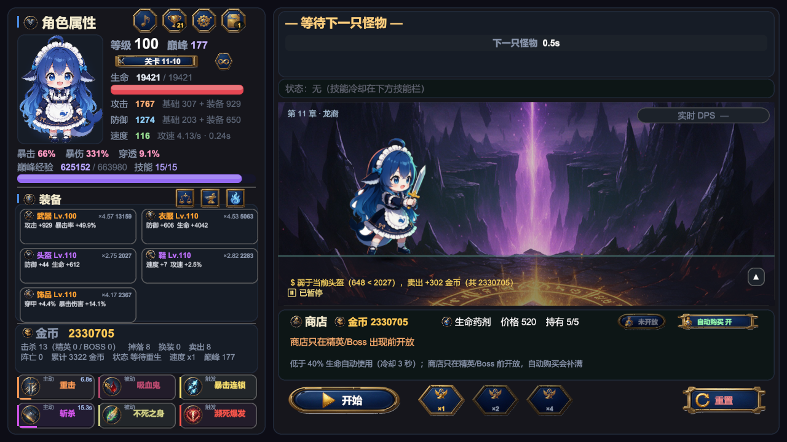

## 玩法

- **自动战斗**：主角与怪物按各自的攻击间隔自动互殴，伤害公式为 `攻击 × 攻速 × (1 + 暴击率 × (暴击倍率 − 1))`，防御按 `护甲 / (护甲 + 系数 × 等级)` 减伤。
- **五槽装备**：武器 / 衣服 / 头盔 / 鞋 / 饰品五个槽位；头盔通关 3-10、鞋 6-10、饰品 11-10 后解锁，解锁时送一件同等级稀有起步件。小件只带 2 条副词条、数值按 50%，且副词条池不出暴击率，避免五槽完美装把暴击率堆到溢出。
- **装备掉落与自动换装**：掉落基础概率 30%，每多一个已解锁槽位 +5%（五槽 45%）；30% 的掉落会优先补空槽或评分最低的槽。按「增量期望 DPS + 有效生命/8」评分，高于同槽当前件就自动穿上，否则卖掉换金币。
- **手动换装与锁定**：关掉设置里的「自动换装」，或把当前装备锁住后，更强的掉落会进「待选」（每个槽位只留最高分的一件，不进存档，换装/卖出/换档/读档即清空）。点左上「对比」或直接点某张装备卡开对比面板：顶部五个槽位页签，两栏列出当前件与待选件的主属性、词条、评分与 Δ，逐项差分成两行（主属性 / 词条）并标红绿；再决定换装、按等级与品质折价卖出，或锁定当前件。比当前差的掉落不会进待选，直接卖店。
- **设置与新手引导**：左上齿轮按钮（原「⚙ 设置」）可分别关掉伤害飘字、实时 DPS、装备评分、技能推荐分与自动换装，另有主音量 / 音效音量两组 10 格音量条与 ± 微调（实际音量 = 主音量 × 音效音量）——改动立刻生效；背景音乐音量在音符面板里单独调（同样与主音量相乘），存在本机 PlayerPrefs（与存档槽无关），也能一键恢复默认或重看引导。底部「显示」入口管全屏 / 8 档分辨率预设（含 16:10、21:9）/ 是否允许窗口缩放 / 色弱友好（品质色换成蓝绿、天蓝、紫红、橙，品质名照旧）；窗口设置在构建后的程序里启动时应用，编辑器内只保存不挪 Game 视图。首次启动自动弹 6 步新手引导：全屏压暗、按步骤在目标控件上挖洞并描金边，会冻结战斗（避免在教程里被打死）；走完或跳过会记标记，之后不再自动弹。
- **音效与背景音乐**：14 个最小音效集（按钮点击、面板开合、普攻/暴击、金币/卖出、升级、成就、BOSS 出场、阵亡、强化、洗练、购买、药剂），命中音 45ms 节流；音频源 `ignoreListenerPause`，暂停面板里也能听见点击。BGM 是本地四首曲目（Let me go / 大肥鱼人是猫 (Remix) / 我会去拥抱他 / 我的悲伤是水做的（大肥鱼版）），顶部音符面板可自选、暂停/继续、上一首/下一首、列表循环或单曲循环，并单独调音乐音量；播放状态与上次曲目记在 PlayerPrefs。音效来自 Kenney 的 CC0 包，BGM 来自项目所有者的本地文件（不随仓库分发），逐条来源见 [docs/audio-credits.md](docs/audio-credits.md)。
- **技能推荐分**：`SkillAdvice` 按当前面板（攻击/攻速/暴击/生存）给每张技能卡打 0~100 分并分档（一般 / 好用 / 很强），三选一与技能池里最高分的卡带金色 ★ 与金色强调条。分数只用来排序，不参与战斗结算；不需要时可在设置里关掉。
- **强化与洗练**：强化（+1~+15）只抬主属性，费用随等级与品质涨；洗练重抽**全部**副词条、条数不变（与掉落同一张分布），主属性与强化等级不动，费用按次数 `×(1 + 0.6n)` 递增。洗练不抬高任何一条词条的天花板，只是用金币把「等一件好词条」的方差换掉——这也是终局金币的第一个出口。词条行可以点着锁住，锁住的那条不重抽，费用按 `3^锁条数` 加价（锁 1 条 ×3、锁 3 条 ×27）：锁得越多单次越贵，但追一条好词条的总花费反而可能更低，买的是确定性不是上限。设计与验收清单见 [docs/equipment-reforge.md](docs/equipment-reforge.md)。
- **技能三选一**：满级后每 10 级巅峰发一次，从随机三个候选里选一个装进技能槽（共 6 槽）。平衡探针会用 `ProbePolicy` 对每个候选实打三种关底 BOSS 后按胜场/剩余血量择优；游戏内仍由玩家自己选。
- **关卡制**：11 章 × 10 关，第 N 章怪物 Lv.10(N−1)+1 ~ 10N（1-1 是 Lv.1 小鸡，11-10 是 Lv.110 BOSS），每关击杀 3~6 只，最后一只为关底精英或 BOSS。怪物等级不跟着主角走；怪物经验随等级线性抬高（`GameConfig.ChapterExpFactor`），保证主角等级能跟上章节。
- **巅峰等级**：满级后继续攒经验换巅峰等级，每级 +1 攻 / +1 防 / +50 生命，每 10 级发一张技能卡（共 15 张，槽位 6 个，多出来的要自己取舍）。巅峰经验 = `2000 + 200p + 20p²`（P0→P200 累计 5,731 万，P0→P1000 累计约 67.5 亿）；P0→P200 纯战斗约 1.0 小时、含刷怪与商店约 2.7 小时（2026-10-21 五槽实测 62.2 / 164.8 分钟），P0→P200 即可通关第 11 章（终局墙按 P60 左右设计）；P0→P1000 约 301 小时（1× 连续，约 12.5 天；4× 约 75 小时），是给长期玩家的沙盒目标，不是通关必需。
- **阵亡 = 回去刷小怪**：阵亡不给经验，只把本关击杀数清零。想变强就回去刷本关小怪（经验只从活着的怪身上拿），再回来打精英 / 关底——打小怪 → 打精英/BOSS → 阵亡 → 回头刷小怪 → 再打。
- **关底是连续的消耗链**：精英战前不回血（血量从上一只怪一路带过来），只有关底 BOSS 战前回满。11-10 的终局 BOSS 按挑战次数轮换类型（近战 → 远程 → 暴击怪），不再靠掷骰决定难度。
- **多存档槽**：3 个互不影响的存档，进度、金币、装备、技能各自独立；每槽可改名（最多 12 字）、可把进度复制到另一个槽（覆盖已有档要 3 秒内二次确认），也能导出 / 导入 JSON。
- **无尽模式**：首通 11-10 或已经转生过即可解锁（满级 100 才能进）。每清完一层立刻进下一层，每 5 层一个 BOSS；怪物等级 `110 + (层-1) × 6`，HP/攻/防再乘 3.4（2026-10-25 D2 由 2.8 上调）。死亡或撤退结束本局，最高层只记「已清除」的层，分本档与全局两个记录；再次挑战从 `min(本档最高, max(1, 本档最高 − 4) + 成就兑换 0~3)` 开始，也可从第 1 层重来；成就点可在成就面板兑换无尽建议起始层（100 点/级，最多 +3 层，不越本档最高层）。层通过发金币、新纪录额外发首通金币，击杀不发金币；掉落与经验等级封顶 150，避免高层装备膨胀。五槽版本下，P1000 + Lv150 满倍率满词条（50 种子、400 层上限）首死中位第 240 层（P10 227 / P90 250 / max 261，无局打满）；随机五槽词条（50 种子，`affixQuality=0.85`）中位 181 层（P10 161 / P90 195 / max 205）。2026-10-25 D2 把 `EndlessBaseFactor` 从 2.8 收紧到 3.4 后，理想配装回到设计目标 235~250；随机配装接受更早死（旧 3 种子口径的 242 是误读，2.8 下 50 种子实际 220）。详细基线与实验见 [docs/endless-mode.md](docs/endless-mode.md) §12.5.4。
- **转生（轮回）**：通关 11-10、满级且巅峰达到 100 后，在存档面板进入轮回。印记按本世巅峰（每 100 级 1 枚，上限 10）、无尽最高（每 50 层 1 枚，上限 5）、金币（每 10 万起按 2 的幂，上限 14）折算，另加基础 1 枚；印记购买五条永久升级（战斗 +1%/级、经验与金币各 +20%/级、掉落 +2%/级、起始等级 +3/级、起始金币 500/药剂 1 每级）。2026-10-25 的转生 v2 会保留评分最低的一件装备（其余四槽清空、不退款），并在本档记录最快 5 世（存档 v12 起）。转生重置等级、巅峰、金币、关卡、技能与本世计时，保留印记余额、五条永久升级、成就累计与解锁、无尽最高层、全局纪录与保留装备。每世都要重打 11-10；转生后本世未重通 11-10 时只能从第 1 层开始，重通后恢复检查点，且等级 100 才能再进无尽。设计与实现记录见 [docs/rebirth.md](docs/rebirth.md)。
- **成就**：42 条成就、合计 805 成就点与 7 个称号，按存档槽独立累计；左栏「成就」入口打开面板，可按 6 类筛选、只看未完成、分页查看，打开时冻结战斗。解锁在右侧弹一条 2.5 秒 toast（多条排队；任一模态或通关横幅可见时隐藏，恢复后续播），旧档按可证明状态静默补发、不补金币。成就给成就点、称号与一次性金币，不直接加战斗属性；成就点可在面板底部兑换无尽建议起始层（100 点/级，最多 +3 层），也可佩戴 7 个称号（显示在左栏立绘下方，未佩戴显示「无名旅人」）。「无阵亡通关」要求在第 9/10/11 章从第 1 关连续打完第 10 关。设计与实现记录见 [docs/achievements.md](docs/achievements.md)。

| 技能三选一 | 关卡选择 |
|---|---|
| 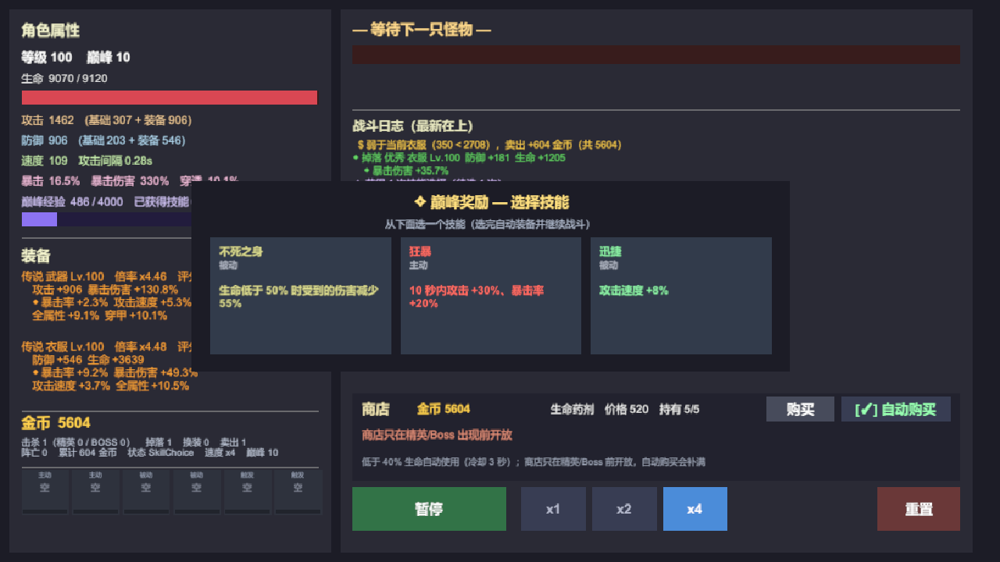 | 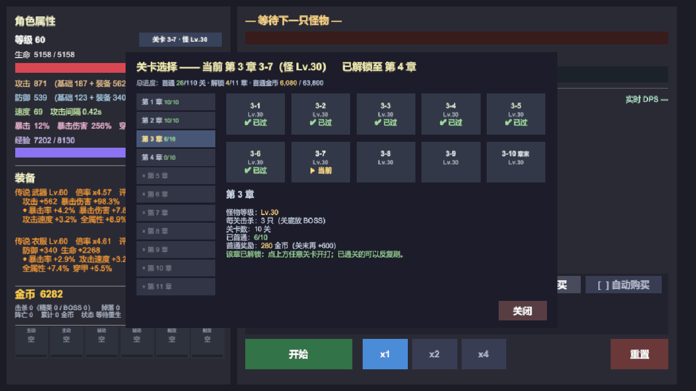 |

| 战斗可读性（飘字 / DPS / 状态栏） | 技能面板 |
|---|---|
| 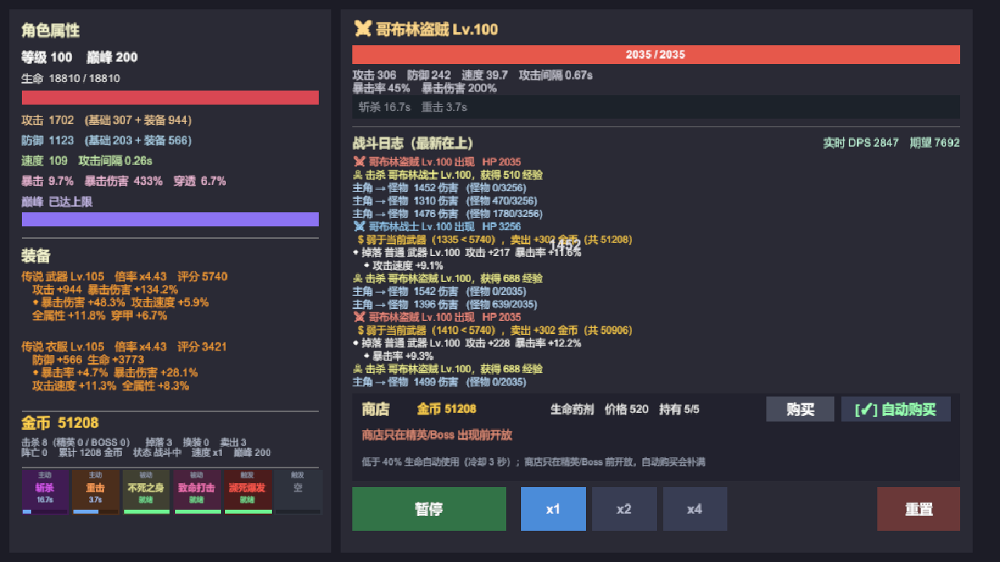 | 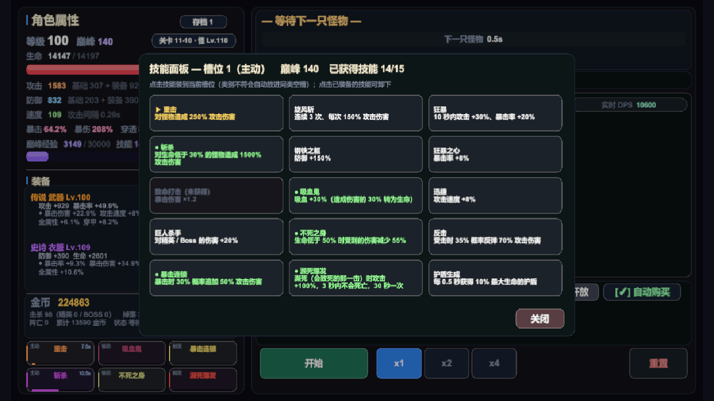 |

| 洗练面板 | 洗练日志（最新在上） |
|---|---|
|  |  |

| 锁 3 条（费用 ×27） | 全锁态 |
|---|---|
|  |  |

| 设置面板（含主音量 / 音效音量） | 装备对比（弱于当前件时红字提示） |
|---|---|
| 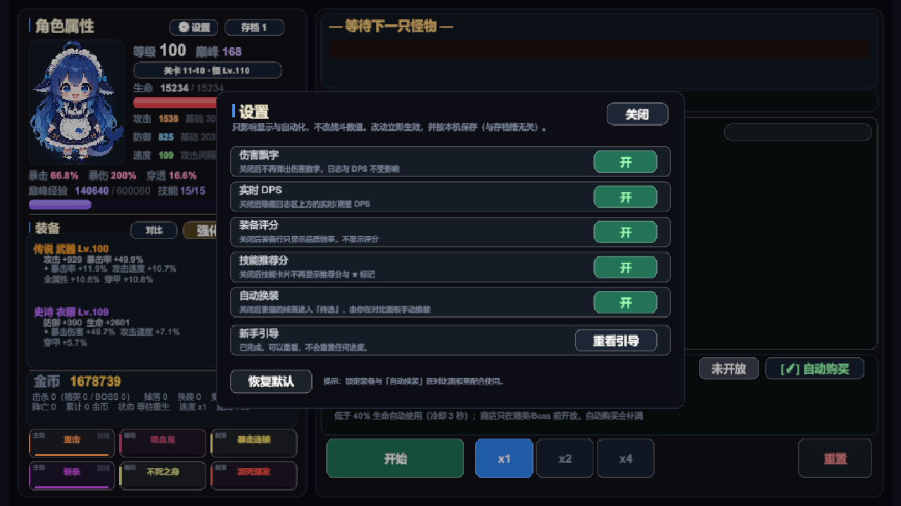 |  |

| 背景音乐（四首 / 自选 / 循环 / 音量） | 主界面顶部音符入口 |
|---|---|
| 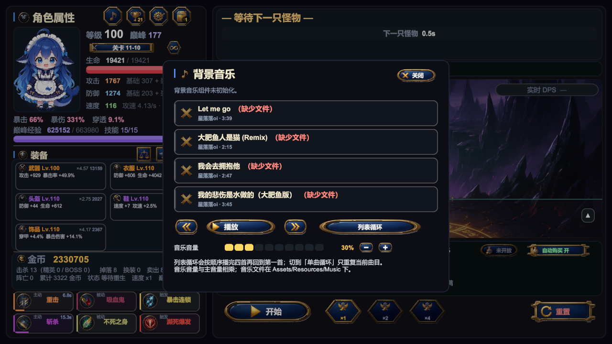 |  |

| 五槽装备（2×3 卡） | 五槽对比（顶部五个页签） |
|---|---|
| 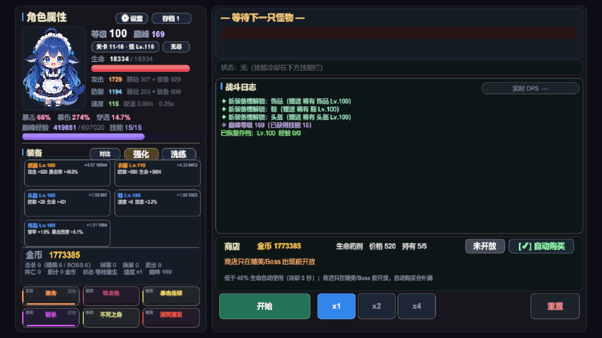 | 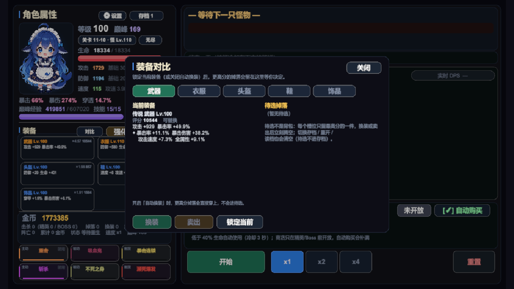 |

| 新手引导（在技能栏上挖洞） | 技能推荐分 |
|---|---|
|  |  |

| 无尽模式面板 | 无尽结算（阵亡 / 最高层） |
|---|---|
| 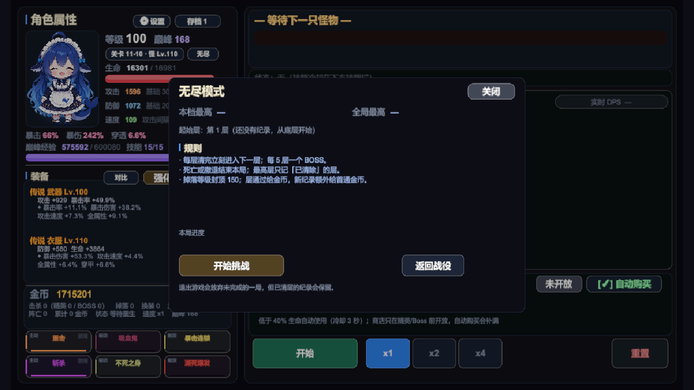 | 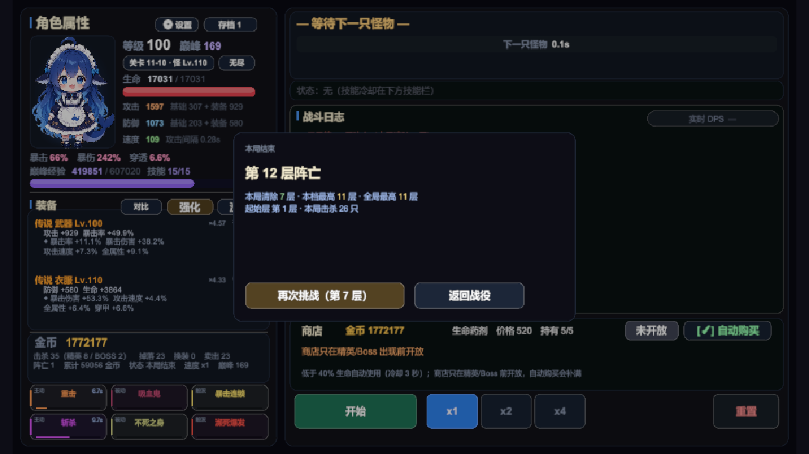 |

| P1000 面板（巅峰已达上限） | P1000 无尽 215 层 |
|---|---|
|  |  |

| 轮回入口（存档面板） | 轮回面板（五条永久升级） |
|---|---|
|  |  |


| 成就面板（分类 / 分页 / 进度） | 解锁 toast（右侧，不挡操作） |
|---|---|
|  | 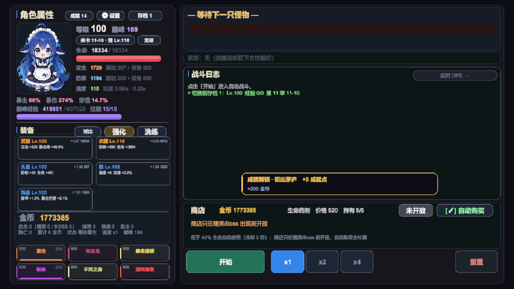 |

| 多形状按钮（开始 / 重置 / 速度 / 装备入口） | 战斗态（怪物卡 / 暂停图标 / 技能冷却） |
|---|---|
|  | 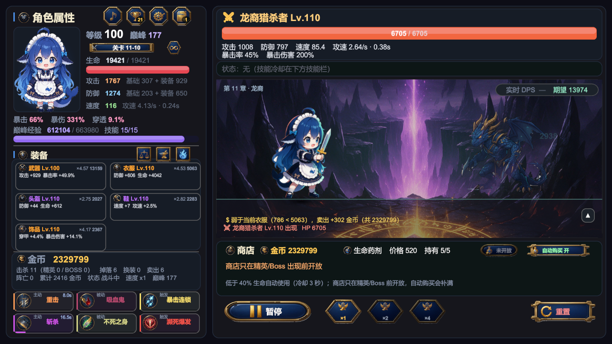 |

| 立绘待机（呼吸 / 轻微摆动） | 眨眼帧 |
|---|---|
|  | 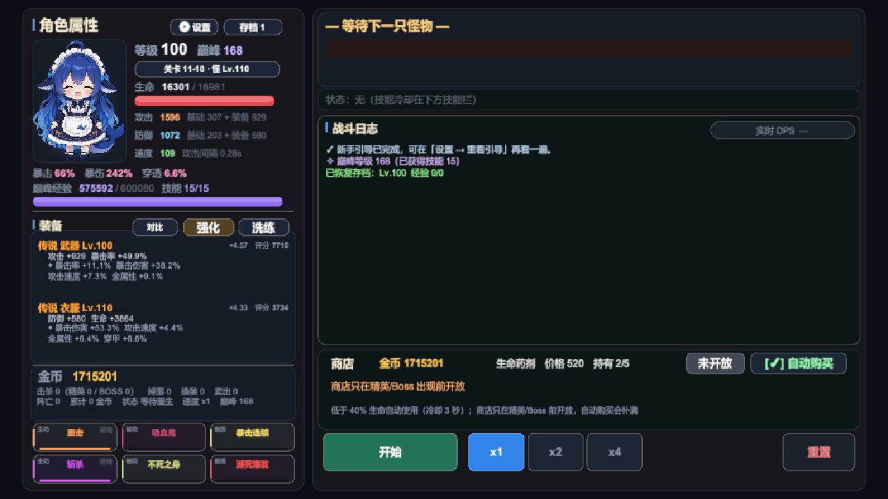 |

## 界面

界面全部由代码搭建（`GameUI` 主文件 + 二十七个 partial，共二十八个文件，按构建 / 浮层 / 刷新 / 主题 / 对比 / 设置 / 音乐 / 立绘 / 无尽 / 转生 / 成就 / 图标 / 按钮 / 舞台等职责拆分，账见下方「已知问题」），没有 prefab。美术资源是主角立绘 + `Resources/Sprites` 下 74 张战斗精灵（主角 1 / 怪物 33 / Boss 11 / 特效 20 / 光环 5 / 章节背景 4）+ `Resources/Icons` 下 85 个透明 PNG + `Resources/Sfx` 下 14 个 OGG 音效（Kenney CC0）+ `Resources/Music` 下四首本地 MP3。图标包括 36 个 256×256 圆形徽章（功能入口、技能、属性）、16 个命令 glyph（播放 / 暂停 / 重置 / 关闭 / 购买 / 换装 / 卖出 / 锁定等）、17 个功能 glyph（含音乐音符）、16 张深海军蓝珐琅底框（长条 / 缺口长条 / 方形 / 八角 / 六边 / 盾形 / 丝带 / 药丸 / 椭圆 / 页签 / 横幅等）。功能入口是 44×44 / 40×40 / 34×34 的图标徽章，成就数、存档号做成右下角深色数字；命令按钮换成长条/方形/六边形底框 + 金色 glyph + 名称，开始/暂停、关闭、换装、卖出、购买、强化、洗练、页签共用同一套；音效由 `GameAudio.cs` 播放，BGM 由 `GameMusic.cs` 播放。紧凑入口没有文字，鼠标悬停显示名称（点下后立即收起）；速度按钮是图标在上、×1/×2/×4 在下的竖向排布。图标由 Seedream 生图、去白底、按圆或形状切图后导入为 Single Sprite。参考分辨率 1280×720，CanvasScaler 用 Expand，所有面板挂在居中的 `ContentRoot`（1280×720）上——窗口比例不对时内容居中、两侧留白，而不是被拉伸变形。

- **左栏**：主角立绘（`Resources/HeroPortrait.png`，140×179 卡片，垫一层冷色背光 + 脚下一滩地灯，否则深色立绘会陷进同样深的面板底；带呼吸、轻微浮动/摇摆和随机眨眼，眨眼帧是同图只闭眼的 `HeroPortraitBlink.png`，整体变换不重绘角色）→ 属性列贴到立绘右侧（等级 / 巅峰 / 关卡 / 生命条 / 攻防速；速度行同时写出有效攻速与攻击间隔），暴击与巅峰经验走整幅宽行 → 装备（2 列 × 3 行、共五张紧凑卡，每卡显示品质色标题/等级/强化 `+N`、主属性，右上角「倍率 · 评分」；悬停卡面会解释倍率与评分的含义，点卡直接打开该槽位的对比）→ 金币与战绩统计 → 6 格技能栏（3 列 × 2 行，主动 / 被动 / 触发各两格，空槽是 `＋`）。
- **右栏**：怪物卡（名字等级、血条、属性行、状态行；空场时血槽走 `RowBg` 并显示「下一只怪物 N.Ns」）、战斗日志（`实时 DPS` 挂在标题右侧）、商店、操作按钮，最底部一条常驻「当前目标」（左侧推图/轮回/无尽，右侧下一件成就进度）。
- **键盘快捷键**（2026-10-23 新增）：空格 暂停/继续、`1` / `2` / `4` 切战斗速度、`Esc` 关掉当前浮层（没有浮层时暂停/继续）、`R` 重置。有浮层打开时只响应 `Esc`（三选一、引导、无尽结算不走 Esc）；按键走新输入系统的 `Keyboard.current`，需要游戏窗口有焦点。

配色语言在 `GameConfig.Colors.cs`：

- 底色分四级——`PanelBg` 面板、`CardBg` 卡片、`RowBg` 行、`CardBgDim` 空槽，靠明度差分层，不堆描边。
- 文字分四档——`TextTitle` 标题、`TextNormal` 正文、`TextMuted` 注释、`TextDisabled` 占位。
- **技能色只染 5% 卡底 + 左侧 3px 强调条**，名字保留本色。工程是 Linear 色彩空间，脚本里的线性值转 sRGB 会被提亮，所以染色比例必须压得很低：12% 上屏就已经像调色板。
- 按钮底板与悬停提示集中在 `GameUI.Buttons.cs`：`StyleIcon` 是纯图标/角标（顶部与装备入口），`StyleBar` 是图标在左、名称在右（开始/暂停、关闭、换装、购买、强化、洗练），`StyleStack` 是图标在上、短名称在下（速度 ×1/×2/×4），`StyleTab` 只换底框、保留文字（章节/成就分类）；图标按钮挂 `UITooltipTrigger`，悬停显示名称，点下立即收起。
- 浮层统一 `OverlayBg` + 圆角 + 1px 边，打开时全屏压一层 55% 黑（`ModalDim`）。所有浮层（选关 / 技能 / 强化 / 洗练 / 存档 / 设置 / 音乐 / 对比 / 无尽 / 轮回 / 成就 / 引导）**互斥**，任一浮层打开时其余都会关闭；三选一没选完时其余浮层一律拒绝打开（否则候选卡会叠在浮层上面）。装备标题行右侧并排三枚 40×40 图标按钮（天平 / 铁砧 / 蓝火），分别打开对比 / 强化 / 洗练；强化与洗练面板同构：顶部五个槽位标签 + 单张卡详情。洗练卡列主属性、副词条、`词条质量 73%（4 条）已洗练 2 次`、本次费用；金币不够时按钮压暗、费用行标「（不足）」，卡片内容仍按真实数值显示。卡里的词条行可点：`◆ 已锁` 的行不重抽、行首 3px 竖条转金色，费用行同步写「（锁 3 条 ×27）」；锁满时按钮压成「已全锁」，费用行改「费用 ——（词条已全部锁定）」。

设置面板 5 行开关（伤害飘字 / 实时 DPS / 装备评分 / 技能推荐分 / 自动换装）加一行重看引导，下面是主音量 / 音效 / 音乐三组 10 格音量条与 ± 微调（音乐音量与背景音乐浮层里的那组是同一个值），开关按钮右侧写清「关掉之后会发生什么」，底部是恢复默认、「显示」「关于」三个入口、一条提示与一行快捷键说明；关于页显示版本号、存档版本与槽数、Unity 版本、导出目录，以及 AI 素材声明与 BGM 署名；显示页管全屏、分辨率、窗口缩放与色弱配色。背景音乐面板是 600×486 的独立浮层：四张曲目卡（当前曲高亮）、上一首 / 播放暂停 / 下一首 / 循环模式，下面是 10 格音乐音量与 ± 微调，底部说明列表循环与单曲循环的区别。装备对比面板与它们同构：顶部五个槽位页签，左栏当前件、右栏待选（含评分 Δ 与逐项差），底部换装 / 卖出 / 锁定三个动作；锁定时按钮变「解除锁定」、当前件标注 🔒 已锁定，天平图标在有待选时转金色。新手引导一层四块遮罩拼出洞口（四边各 1px 金边），洞口放一块几乎全透明的拦截层：被指到的控件自己可点，但点在别处不会顺手开出选关/技能面板；卡片按目标方位自动放到对角，第 1 步无目标时居中。成就面板是 808×620 的独立浮层：顶部 7 个页签（全部 + 6 类），下面 2 列 × 8 行，每行左侧 4px 级别色条、名称、描述、右侧进度/点数；完成行压暗并标 `✓ 已完成`，有称号的条目把金色称号接在名称行。底部「只看未完成」与上一页/页码/下一页，再下一行是 7 个称号佩戴按钮（锁定灰显、已佩戴带 ✓，再点一次卸下），42 条分 3 页（16/16/10），打开时每 0.5 秒只刷新进度文本。解锁 toast 固定 600,430、500×56，排在通关横幅之上、所有浮层之下；任一模态或横幅可见时整条隐藏并暂停 2.5 秒计时，恢复后再续播。

**2026-10-24 可用性补丁**：战斗速度记在本机（下次启动仍是上次档位，恢复默认会回到 ×1）；强化面板除单次外还有「+5」「满级」两档批量，逐级扣费、金币不足时停在买得起的等级并提示差额；属性区（暴击/暴伤/穿透）、巅峰经验、6 张技能卡、无尽起始层与洗练质量都补了悬停解释；10 格音量条的未填充格提亮并加描边（30%/80%/100% 一眼可数）；音乐面板曲目卡带进度条与 `mm:ss / mm:ss`，暂停时冻结。

飘字（伤害数字）的规则：只给「主角 → 怪物」的伤害飘字，怪物打主角看日志和左栏血条就够；普攻落在怪物血条右半段，非暴击按一半概率丢弃；暴击 19 号、普攻 14 号、技能 17 号；寿命 0.55 秒，三条纵向轨道轮流落点——攻速 0.27 秒时同屏 2~3 个数字，再密就糊成一片（早期版本 26 号字、1.15 秒，直接把日志盖住了）。

刷新分两层走：`Refresh()` 每帧只做**静态签名比对**——把该显示的字段塞进一个 `Sig` 结构，签名不变就不碰字符串、不改组件颜色；文本类（金币、冷却秒数、商店倒计时）按 0.1 秒节拍单独再走一遍。技能栏的冷却条是唯一每帧重绘的东西，还带 0.05 像素去抖。实测暂停时每秒约 1 次重建，x4 战斗约 8 次/秒；改造前是每帧无条件重建约 30 条字符串（连装备评分和 DPS 都每帧重算）。

日志写入只有一个实现：`BattleLog.Append`（私有）负责累计条数、裁剪与版本号，对外分 `AddSystem`（系统 / 进度 / 商店）与 `AddCombat`（战斗过程）两个频道——`GameController.AddLog` 走前者，`BattleSystem` 走后者。分频道不是为了计数，是为了以后按频道过滤、配色时有地方挂，也逼新写日志的人先回答「这条属于哪一类」。

## 运行

1. 用 **Unity 6000.6.5f1** 打开 `HelloWorldProject/`（Universal 2D 模板）。
2. 打开 `Assets/Scenes/SampleScene.unity`。
3. 点 Play。场景里只有一个 `Bootstrap`，它在 `Awake` 里依次 `AddComponent` 出 `GameAudio`、`GameMusic`、`GameController` 和 `GameUI`，界面全部由代码构建，**没有任何 prefab 依赖**。

## 项目结构

```
HelloWorldProject/Assets/
├── Scripts/                 运行时 59 个 .cs / 17,253 行 + AutoBattle.Runtime.asmdef（2026-10-25 实测）
│   ├── 入口与状态机（5 个 / 2,459 行）
│   │   Bootstrap 23 · GameController 1681 · GameController.Endless 322 ·
│   │   GameController.Rebirth 259 · GameController.Achievements 174
│   ├── 战斗 · 关卡 · 掉落 · 技能（9 个 / 1,972 行）
│   │   BattleSystem 483 · BattleLog 70 · Endless 310 · Stages 136 · LootSystem 308 ·
│   │   EquipmentScore 105 · Skills 220 · SkillCatalog.Loader 191 · SkillAdvice 149
│   ├── 数据模型（4 个 / 1,348 行）
│   │   Models 661 · Models.PlayerData 609 · Models.Achievements 48 · Models.PlayerStats 30
│   ├── 配置层（5 个 / 1,432 行）
│   │   GameConfig 591 · .Colors 166 · .Loader 258 · .Tables 250 · GameConfigData 167
│   ├── 存档 · 设置 · 音频 · 随机（5 个 / 1,650 行）
│   │   SaveSystem 934 · GameSettings 331 · GameAudio 105 · GameMusic 264 · GameRandom 16
│   ├── 成就与转生目录（3 个 / 728 行）
│   │   AchievementCatalog 181 · AchievementSystem 330 · RebirthCatalog 217
│   └── UI（28 个 partial / 7,664 行，明细见「已知问题」的 `GameUI` 条目）
├── Editor/                  编辑器工具（10 个文件 / 4,138 行 + AutoBattle.Editor.asmdef；2026-10-25 实测）
│   ├── LateGameProbe 686 · BalanceRegression 628 · NewGameProgression 509
│   ├── EndlessPacing 493 · EndgamePacing 232 · ProbePolicy 310
│   ├── AchievementRegression 1,020 · SkillTableVerify 104
│   ├── GameConfigReloader 50     菜单：重读 game_config.json
│   └── AutoBattle.CI.cs 106      QuickRegression：一键快速回归 / batchmode 入口
├── Tests/                   EditMode NUnit（1 个 .cs / 133 行 + AutoBattle.Tests.asmdef）
│   └── EditMode/AutoBattle.Tests.EditMode.cs  8 条用例
├── Resources/
│   ├── game_config.json     可热改的标量配置（缺键会在加载时打警告）
│   ├── skills.json          15 个技能的数值表
│   ├── achievements.json    42 条成就定义（ID / 类别 / 指标 / 目标 / 点数 / 金币 / 称号）
│   ├── Icons/               85 个按钮底框 / glyph / 徽章图标（透明 PNG）
│   ├── Sfx/                 14 个 Kenney CC0 音效（OGG）
│   ├── Music/               四首本地 BGM（MP3，已 gitignore，不随仓库分发）
│   └── HeroPortrait*.png    主角立绘
└── Scenes/SampleScene.unity
```

> 上面每个文件后的数字是 2026-10-25 用 `Get-Content <file> | Measure-Object -Line` 实测的行数，分组小计与 59 个文件的总量（17,253）逐项对得上；`GameUI*` 已于 2026-10-23 拆成 28 个 partial，分组与明细记在「已知问题」的 `GameUI` 条目，不再逐个列进结构块。单文件行数会随改动漂移，动手前重新量一遍收益比背旧数高。

仓库根目录还有几个不属于 Unity 工程的资产：

- `_balance/` —— 平衡回归基线（`baseline.json`）、探针说明（`README.md`）与冒烟截图（`shots/`），放在工程外以免被 Unity 导入。
- `_art/` —— 素材与一次性验证产物的统一根目录（**约定：一次性产物一律放 `_art/<主题>/`，不入库**；索引见 [`_art/README.md`](_art/README.md)）。根目录是立绘源图、生成提示词与处理脚本；`ui-audit/`、`topn/`、`sprites/`、`stage/`、`tmp-verify/`、`fish/` 是按主题归档的截图与中间产物（均 gitignore）。
- `docs/` —— 玩法设计与实现记录（装备洗练、无尽、转生、成就、音频来源等），外加整体待办清单 [docs/roadmap.md](docs/roadmap.md)；`docs/shots/` 是本文引用的界面截图（26 张 / 7.1MB，从 `HelloWorldProject/Assets/Screenshots/` 迁出，避免 Unity 导入这些纯文档图）。
- `tools/` —— 仓库级脚本：`quick-regression.ps1` 一条命令跑「静态哨兵 + 成就核心 + 无尽冒烟」；`run-editmode-tests.ps1` 跑 8 条 EditMode NUnit；`build-windows.ps1` 一条命令出 Windows x64 包（见下文「构建与 CI」）。
- `.github/` —— GitHub Actions 流水线：`workflows/unity-ci.yml` 在 `windows-latest` 上跑快速回归 + EditMode NUnit + Windows 构建（见下文「构建与 CI」）。
- `.mnemon/` —— 项目知识库与热记忆，跨会话接手时从这里读。
- `_archive/` —— 归档区（已 gitignore）：`legacy/` 是拆分前的旧版 `GameController.cs`/`GameUI.cs` 与文件头备份，`screenshots/` 是早期开发截图。不进 Unity 工程，也不会被导入。
- `dsh-image-gen/` —— 生图插件的输出目录（已 gitignore）。

## 配置热改

`Assets/Resources/game_config.json` 里的**标量**（数值系数、倍率、开关）在编辑器里保存后会触发重载，Play 中立即生效，不需要重编译；打包后只在启动时加载一次。`GameConfig.Tables.cs` 里的**数组表**（技能表、章节怪物名、属性偏向等）是编译期常量，改 JSON 无效。两处的边界在 `GameConfig.Tables.cs` 头部有注释说明。

## 平衡回归

改数值之后跑一遍，能立刻看出是否把某档平衡打歪了：

- 菜单 **Tools/平衡回归/** → 静态哨兵（技能表、公式采样、关卡表、怪物样本、评分自洽性，外加新档过渡轨迹，约 1.2 秒；前五张表逐字符比对，过渡轨迹按容差比对）
- 胜率表（8 个巅峰档 × 4 个难度格，约 25 秒，容差 0.5 个百分点）

设计要点：战斗随机全部走 `UnityEngine.Random`，用 `Random.InitState` 固定种子让整轮模拟逐位可复现；每个巅峰档用独立种子，这样改动能定位到具体某一档。基线存在 `_balance/baseline.json`。

`NewGameProgression.cs` 补的是另一类问题：**新档能不能玩**。它从 `new PlayerData()`（Lv.1、空身、无金币）起步，逐关模拟"打小怪→回满血打关底"，死了重试，直到通关或卡住，输出每章末等级/阵亡数/耗时。菜单 **Tools/测试/新档进度探针（从头打到底）**，或命令行跑 `AutoBattle.EditorTools.NewGameProgression.Run(seed, maxAttemptsPerStage, verbose)`。改动关卡强度、经验曲线、掉落权重后都该跑一遍。

它同时是回归门禁的一部分：逐章轨迹（章末等级/尝试/阵亡/耗时）写进 `_balance/baseline.json` 的 `transition` 小节，静态哨兵每次都会比对；另外 `CheckInvariants()` 有无需基线的硬约束——不卡死、每章末等级不低于下一章怪级下限、终局 Lv.≥95、阵亡 ≤120 次、时长 ≤45 分钟。整轮模拟只要 20 毫秒左右，所以挂在毫秒级门禁上不心疼。

成就系统的 §11 回归挂在 `Assets/Editor/AchievementRegression.cs`（菜单 **Tools/测试/成就 §11 回归（核心/探针）**）：`RunCore()` 覆盖 42 条指标边界、固定金币幂等、统计记账、无阵亡挑战、v0/v5/v8/v9 迁移、v14 拒读（版本上界从 `CurrentSaveVersion` 常量推导，升版不会静默失效）、schema>1/坏档拒读与存档写失败保护，2026-10-22 为 644 项 / 0 失败（2026-10-25 升 v13 后复跑仍 644 / 0）。探针部分同时跑新档（含成就金币上界注入）、终局、无尽与真实转生：新档 13.7min / P41 / 阵亡 2；P200 五槽终局余额 5,864,020；合法五槽 P1000 无尽中位 240 层（250 层 4/10）；真实转生印记 +19，成就/统计/无尽纪录跨世保留。详见 [docs/achievements.md](docs/achievements.md) §15.2。

转生接入后，`NewGameProgression.Run(...)` 与 `EndlessPacing.Run(...)` 都可额外接收五条 rank（默认 0）；新档探针按 `RebirthStartLevel/StartGold/StartPotions` 造起始角色，无尽探针把对应倍率套到满装模板；2026-10-20 已跑 50 种子分布：第 2 世到 11-10 为第 1 世的 92.4%，满轮回 63.5%，都慢于目标 75~85% / 35~50%；2026-10-22 按洗练 0.9 口径复测为 90.8% / 61.8%，同日落地 Exp 0.60 + Legacy 3 并复跑为 82.6% / 47.1%；详见 [docs/rebirth.md](docs/rebirth.md) §14.4。

`EndlessPacing.cs` 回答的是**无尽能打多深**。它从「Lv.100 巅峰 200、15 技能、传说 Lv.110 +15、词条 80%」的满装模板起，用固定种子逐层模拟（默认 20 个，可传种子数），输出首死层数分布、层通关率、单层 P50/P90 耗时与 50 层经济，也可以传 `paragonLevel` / `gearLevel` / `affixQuality` / `maxGear` 换模板。菜单 **Tools/测试/无尽节奏探针（首死层数与耗时）**。当前基线：P200 模板（2.8 口径，3.4 下未复测）首死中位 45 层（P10 30 / P90 50 / max 60），单层 P90 最大约 16 秒，50 层累计金币约 37 万；P1000 + Lv150 五槽满倍率满词条（maxGear、50 种子、400 层上限）首死中位 240（P10 227 / P90 250 / max 261，无局打满），随机五槽（50 种子、`affixQuality=0.85`）中位 181。详见 [docs/endless-mode.md](docs/endless-mode.md) §12.4–§12.5.4；2026-10-20 满轮回（战斗 +5%）曾把同一指标推到中位 315 层，那是 2.8 口径，3.4 下尚未复测（[docs/rebirth.md](docs/rebirth.md) §14.4）。

`EndgamePacing.cs` 回答的是另一个问题：**满级之后要磨多久**。它从「Lv.100 + 传说装备 + 巅峰 0」起，在 11-10 反复「5 只小怪 + 轮换 BOSS」，输出首次通关的巅峰/耗时、以及 P1/P30/P50/P100/P150/P200/P300/…/P1000 的里程碑，并同时给「纯战斗」与「含刷怪+商店」两种时间。默认会在每次 BOSS 前把词条洗到 80% 质量（`reforgeQuality` 可关掉），输出会带洗练累计花费。菜单 **Tools/测试/终局节奏探针（巅峰 0 → 目标）**。改巅峰经验曲线、终局 BOSS 强度后跑这个；P1000 用 `Run(20261018, 200000, false, 1000)`。2026-10-19 两槽口径历史结果：119,963 次挑战、244 阵亡、纯战斗 7,781.8min、含等待 19,775.8min，收尾 8.59 亿金币。2026-10-20 五槽 P200 复测：1028 次挑战、6144 击杀、24 阵亡、含等待 164.8min、余额 5,864,020。2026-10-22 五槽 P1000 复测（洗练 0.9）：119,834 次挑战 / 718,973 击杀 / 31 阵亡 / 纯战斗 5,528.7min、含等待 17,511.8min / 收尾余额 859,284,167。

几个探针共用 `Assets/Editor/ProbePolicy.cs` 这一层「玩家决策」：技能三选一不再是「永远拿第一张卡」，而是把每个候选真打三种 Lv.110 BOSS、按「赢得多快 / 输得多惨」打分；金币也不再只买药，余钱按「每金币换多少 `DPS + 有效生命/8`」挑强化槽位砸下去；每次 BOSS 前还会用 `SpendGoldOnReforge` 把词条质量洗到 80%（锁住已达标的词条，不追 90%）。探针算的是**会挑会花的最优玩家**，真人只会更慢。

这一层直接把一条结论掀了：同一组种子，旧探针（随机拿卡、从不强化）量出的满级时间（纯战斗）是 136.6 / 110.3 min，换成 `ProbePolicy` 后只剩 76.3 / 77.3 min。于是把 `ParagonExpQuadratic` 从 12 抬到 20，重跑回到 **108.0 / 113.7 min**——「满级纯战斗大约两小时」靠的是这条曲线，不是探针的迟钝；加上刷怪与商店等待约 3.8 小时。这是 2026-10-18 旧口径（当时探针不洗练）；2026-10-19 接入洗练后 P200 为 117.2min 纯战斗 / 229.3min 含等待。

`LateGameProbe.cs` 是开发和探索阶段留下的一批实验入口：胜率表（`RunWinrate` / `RunChapterWinrate`，`BalanceRegression` 与 `_balance/` 的数据来源）、单场对局诊断（`Diagnose`）、技能 / 连携 / 生存审计（`SkillAudit` / `ComboAudit` / `SurvivalAudit`）。2026-10-21 清掉了评分口径切换时用过的 `ScoreAudit` / `ScoreRankAudit` / `ScoreBattleAudit` / `ScoreDummyAudit` / `ScoreWeightSearch`（连同上文那批只给它们读的 `ScoreWeight*` 配置项），结论已经落在 `EquipmentScore.cs` 的类注释里；剩下的入口读的时候注意看注释里的日期与结论。

## 自动化回归

改完代码/数值至少跑一遍这条链，别只靠肉眼看界面（入口两处，实现都是 `Assets/Editor/AutoBattle.CI.cs` 的 `QuickRegression`）：

1. **Editor 菜单**：**工具/回归/跑一遍快速回归**，Console 输出汇总行，失败项用 `Debug.LogError` 标红。
2. **命令行**（仓库根，Editor 已打开或没打开都行）：

```powershell
pwsh tools/quick-regression.ps1
# 或完全无 Editor 的 batchmode（CI 用，退出码 0/1）：
pwsh tools/quick-regression.ps1 -Batch
```

脚本串起三步：静态哨兵（`BalanceRegression.RunStaticOnly()`）→ 成就核心（`AchievementRegression.RunCore()`，644 项）→ 无尽冒烟（`EndlessPacing.Run(2, 40)`，只要求 2 个种子 40 层跑通、不比对数值）。每步独立 try/catch，一行 `PASS/FAIL — 名称（耗时）`，末尾给「汇总：n 通过 / m 失败」与「结果：PASS|FAIL」；有 FAIL 时脚本退出码 1。2026-10-24 实测三步全 PASS，总耗时约 0.1 秒（Editor 已连接时走 `unity command eval`，不需要重新进 Play）。

**EditMode NUnit（2026-10-24 补上）**：`Assets/Tests/AutoBattle.Tests.EditMode.cs` 共 8 条用例，测试程序集 `AutoBattle.Tests.asmdef` 引用 `AutoBattle.Runtime` / `AutoBattle.Editor` / Unity Test Framework 1.8.0；运行时与编辑器工具也各自有 `AutoBattle.Runtime.asmdef` / `AutoBattle.Editor.asmdef`，不再是预定义的 `Assembly-CSharp`。覆盖：章节压迫公式与单调性、强化费用、无尽起始层回退、装备评分增量与槽位约束、存档 JSON 往返、成就目录 42 条 / 805 点 / 7 称号、静态平衡哨兵。

```powershell
# Editor 关闭时跑（batchmode 独占工程），报告写到 _art/tmp-verify/test-results.xml
pwsh tools/run-editmode-tests.ps1
# 或直接：
unity test HelloWorldProject --mode EditMode --output _art/tmp-verify/test-results.xml
```

2026-10-24 实测 **8/8 通过、0 失败、0 跳过，用时 0.11 秒**。Editor 开着时用 **Window > General > Test Runner** 直接跑；`run-editmode-tests.ps1` 会检测到 Editor 并提示先关闭（exit 2），避免抢工程锁。

## 构建与 CI

本地出一条 Windows x64 包（仓库根，需 Unity 6000.6.5f1 与 Windows Mono 播放器支持）：

```powershell
pwsh tools/build-windows.ps1
# 产物：HelloWorldProject/Build/Windows/AutoBattle.exe（整目录约 172 MB）
# 可选：-OutputPath <路径>、-RequireClean（工作区不干净时拒绝）、-TimeoutSeconds <秒>
```

脚本只包装 `unity build --target StandaloneWindows64`，不自写 `BuildPipeline`；场景列表仍由 `ProjectSettings/EditorBuildSettings.asset` 决定（当前只有 `SampleScene`）。2026-10-25 实测构建成功，`AutoBattle.exe` 0.6 MB、整目录 171.6 MB；构建时会打印一条非致命的 `LicensingClient has failed validation; ignoring`，本机 Personal 许可证实际生效。

CI 在 [`.github/workflows/unity-ci.yml`](.github/workflows/unity-ci.yml)：`runs-on: windows-latest`（Ubuntu runner 没有 Windows Mono 模块，`unity ci init` 默认给的 Ubuntu 模板不适合这个 target），依次跑快速回归（`quick-regression` 的 3 项）、EditMode NUnit（8 条）与 Windows 构建，任一步失败即 job 失败。首次启用需要在仓库 Secrets 里配 `UNITY_LICENSE_SERIAL`（必需；`UNITY_SERVICE_ACCOUNT_ID` / `UNITY_SERVICE_ACCOUNT_SECRET` 可选），并在分支保护里把 `Unity CI / verify` 设为 required check。

边界：**本机链路已验**（NUnit 8/8、构建成功），**GitHub 上的流水线已触发但未跑通**：2026-10-25 两次 `Unity CI` 都在第 3 步「Check required secrets」失败，原因是仓库还没配 `UNITY_LICENSE_SERIAL`（第 4~17 步全部 skipped）。因此 CI 目前是「已触发、待补 secret」，不能当作已通过的保证。

## 开发进度

原始规划 12 步，全部完成；P4 的音效、BGM、2D 战斗舞台、11 族怪物、章节背景与技能特效都已接入（[设计与实现记录](docs/sprites-and-fx.md)）：

| 阶段 | 步骤 | 状态 |
|---|---|---|
| P0 工程基础 | 1 配置外部化 | ✅ |
| P1 核心循环 | 2 装备强化（+1~+15） | ✅ |
| | 3 装备洗练（重铸副词条） | ✅ |
| | 4 关卡/章节推进 | ✅ |
| | 5 技能三选一 | ✅ |
| P2 战斗可读性 | 6 Buff/Debuff 图标栏 | ✅ |
| | 7 伤害飘字 | ✅ |
| | 8 实时 DPS 面板 | ✅ |
| P3 长线目标 | 9 成就系统（42 条 / 805 点 / 7 称号，[设计与实现记录](docs/achievements.md)） | ✅ |
| | 10 转生（重置等级换永久加成，[设计与实现记录](docs/rebirth.md)） | ✅ |
| | 11 无尽模式 + 最高层记录 + 本档 Top-5 历史榜（2026-10-22，[docs/endless-mode.md](docs/endless-mode.md) §6.5） | ✅ |
| P4 表现层 | 12 音效 / 2D 精灵 / 技能特效 | ✅ 最小音效集 + BGM + 2D 战斗舞台（主角 / **11 族怪物 × 3 类型** / **11 张 Boss 立绘** / **8 张技能专属特效** / **档次与词缀光环** / **4 张章节背景** / 可展开日志） |

另外已完成但不在原计划里的：护甲穿透属性、装备评分改口径、多存档槽、平衡回归工具、主角立绘与待机动画、设置面板、新手引导、技能推荐分、装备对比/锁定、击杀结算拆分与终局重复结算修复（2026-10-18）、P1000 上限与无尽天花板实测、平衡探针模拟洗练（2026-10-19）、五装备槽与攻速软上限（2026-10-19）、转生系统（轮回，2026-10-20）、成就系统（42 条 / 805 点 / 7 称号，2026-10-20）、多形状按钮与悬停提示（2026-10-21）、最小音效集与主/音效音量（2026-10-21）、本地四首 BGM 与音乐面板（2026-10-21）、2D 战斗舞台与技能特效（2026-10-21）、无尽本档 Top-5 历史榜与清空按钮（2026-10-22）、4~11 章 8 族怪物与 8 张 Boss 立绘 / 精英与 Boss 档次光环 + 词缀光环 / 4 张章节背景 / 15 个技能特效一一对应（2026-10-22）、存档导出/导入与「关于」页（2026-10-24）、一键快速回归 `AutoBattle.CI.cs` + `tools/quick-regression.ps1`（2026-10-24）、战斗速度记忆与强化批量 / 悬停解释补齐 / 音量格描边 / 音乐进度条、EditMode NUnit 回归 8 条与运行时/编辑器/测试三个 asmdef（2026-10-24）、显示设置（全屏 / 8 档分辨率 / 窗口缩放 / 色弱配色，2026-10-24）、存档槽改名与跨槽复制（2026-10-24）、称号佩戴与左栏展示（2026-10-24）、转生 v2：保留评分最低的一件 + 本档最快轮回 Top-5（2026-10-25）、右栏常驻「当前目标」条（2026-10-25）、Windows 构建脚本 `tools/build-windows.ps1` 与 GitHub Actions CI（2026-10-25，见「构建与 CI」）。

2026-10-18 又补了一轮健壮性：热改配置加载后统一夹到安全区间（防除零/死循环/索引越界），读档时清洗技能与装备字段，切档/删档/重置共用 `ResetSessionState()` 清场，装备评分缓存把技能状态纳入缓存键。

同一天的低风险防御性兜底：越界品质统一回落到普通（不再夹到最高档白送传说）、掉落权重遇到空表/NaN/负值回普通、装备评分对非法槽位与空角色返回 0、战斗追帧每次最多补 256 次并把负计时归位、升级与巅峰经验在 `need <= 0` 时停止、首通金币校验关卡 key 是否在范围内。

## 已知问题

> 这里只记「尚未处理的已知缺陷」，完整的待办清单（A 收尾 / C UI / B 玩法 / D 平衡 / E 文档，含优先级、现状证据与验收口径）见 [docs/roadmap.md](docs/roadmap.md)（2026-10-25 更新）。

- **BGM 是 AI 生成曲目**：四首背景音乐由 AI 音频工具生成，不需要署名或授权，可随游戏直接分发。文件仍是 `HelloWorldProject/Assets/Resources/Music/` 下的 MP3，并按仓库体积考虑写进 `.gitignore`；换机或克隆仓库后目录为空，音符面板会显示「缺少文件」并静默跳过不可用曲目（换曲改 `MusicCatalog` 里的路径与标题即可）。
- **中间章节配装平衡只做了近似验证**：`LateGameProbe` 用"该章预期等级 + 随机精英装备"造人，`NewGameProgression` 从 Lv.1 空身一路打到 11-10（两者都见 `_balance/README.md`）。技能三选一、强化与洗练已由 `ProbePolicy` 接管（洗练默认在每次 BOSS 前把词条质量拉到 80%，锁住已达标的词条，不追 90%），但仍不模拟真人的犹豫：不会卡着不强化攒钱、也不会挑「这关不需要的属性」；手动换装与操作失误也不在探针里。2026-10-19 的 A/B（两槽口径）：新档 seed 12345 不洗练时第 11 章要 97 次尝试（其中 11-10 88 次）/ 87 阵亡 / P60；洗到 80% 后第 11 章只要 20 次（11-10 11 次）/ 10 阵亡 / P44，洗练只花 2,674 金。**这一条在 2026-10-21 五槽复测里没有复现**：同口径 6 个种子（12345 / 777 / 2026 / 4242 / 8888 / 31337，单关上限 30）第 11 章中位尝试「开洗练 22 次 / 关洗练 21.5 次」，单种子差值从 −6 到 +22 次，整体落在种子噪声内；单轮洗练花费 2,465~23,295 金，而同档整轮金币收入只有约 2.3 万——新档里洗练已经是「吃掉过半收入」，不是「只花 2,674 金」。所以**不整体提价**；若要动，只动「同一件反复洗」这一档：`ReforgeCostGrowth` 0.6 → 0.9（首洗 2,762 不变，第 11 次 17,818 → 27,616，31 次滚满 85.6 万 → 124.1 万，端局一套洗到 86% 的平均花费 96.3 万 → 133.7 万）——见 [docs/equipment-reforge.md](docs/equipment-reforge.md) §5.5–5.6，**2026-10-21 已落地**。终局的钱另有账：P1000 全程洗练只花 70.8 万、兜里剩 8.593 亿（2026-10-22，0.9 口径），那是软出口问题，不是单价问题。第 11 章靠反复刷小怪攒巅峰，节奏由 `EndgamePacing` 单独把关。
- **`GameUI` 已于 2026-10-23 按职责拆分（`PlayerData` 不再拆）**：从 14 个 partial 文件拆成 28 个，2026-10-25 实测 7,664 行，最大单文件从 1,342 行降到 714 行（`GameUI.Settings.cs`）。现分组：构建与控件 1,518（GameUI 321 + Build.Left 273 + Build.Right 132 + Factory 108 + Theme 194 + Icons 157 + Buttons 333）；刷新核心 1,003（Core 445 + Fx 232 + Refresh.Log 326）；面板外壳 1,550（Panels 212 + Panels.Save 416 + Panels.Enhance 290 + Panels.Reforge 205 + Panels.Banner 45 + Panels.Stage 213 + Panels.SkillBar 169）；功能面板 2,659（Endless 462 + Achievements 524 + Compare 287 + Settings 714 + Rebirth 269 + Music 270 + Portrait 133）；战斗舞台 934（Stage 263 + Stage.Frame 201 + Stage.Art 224 + Stage.Events 246）。拆分只搬代码不改行为，验收为 `BalanceRegression.RunStaticOnly()` PASS、`AchievementRegression.RunCore()` 644 通过 / 0 失败、Play 冒烟截图 `Assets/Screenshots/ui_split_smoke.png` 正常。`Models.PlayerData.cs` 仍是 604 行，但它是存档模型（字段多、职责单一），没有再拆的计划。
- **终局节奏已按五槽重调并定格（2026-10-23：压迫 5.5%/4%，终局 BOSS 倍率定格 1.6）**：章节压迫 `1 + 5.5%×(章-1)`、章末 BOSS 再乘 `1 + 4%×(章-1)`（第 11 章不吃），终局 BOSS 再额外 ×1.6。压迫在 2026-10-23 由 4%/3% 上调：五槽曾把裸装下界的第 5~8 章抬到 87%/88%/89%/91%（与第 1 章持平），曲线被削平。上调后按 300 套抽样均值（每章每类型 20 场 × 3 次战斗 × 5 个建样种子 `20261016+ch*31+k*9973`，0 巅峰、只穿该章精英掉落）重测关底胜率：第 1~4 章 98.0%/90.7%/90.4%/90.0%，第 5~8 章 79.2%/79.5%/68.2%/60.6%，第 9~10 章 33.8%/21.8%，第 11 章 0%（精英 12.1%）；精英 1~10 章仍 100%。回归哨兵表（`_balance/baseline.json` 的 `chapterWinrate`，seed 20261016、每类型 20 套装备 × 6 次）为 97.1/91.9/92.9/89.8/75.2/56.3/56.0/55.3/22.1/24.7/0，与抽样均值差 0~9 个点（单章只有 20 套装备，容差 ±5 点）。真实推进（30 个种子，单关上限 30）25 全程通关 / 5 摸到 11-10 / 0 卡死、总阵亡 334（第 1 章 44、第 9 章 2、11-10 288，第 2~8 与第 10 章全 0），改前是 24/6/0、总阵亡 394 —— 压迫上调没有伤到通关率。同时量到两条：①要压迫到「认真强化/洗练的玩家」，slope 得 ≥0.08~0.09，但那时哨兵表第 6~7 章就饱和到 0%、失去分辨率，所以停在 5.5%；②第 10 章（深渊 1.10 血/1.10 攻/1.05 防/0.92 速，慢而肉）在多数配置下比第 9 章更容易，是 `ChapterStatBias` 的问题，本次未动。终局侧不吃这一层（第 11 章 `pressure = 1`，无尽模式也不吃），所以五槽后 P100/P150 关底 47%/60%、`EndgamePacing` 首通偏早的问题只能落在 `FinalBossStatFactor` 上；该参数已于 2026-10-23 复测并**定格 1.6**：10 种子首通第 2~62 次（中位 14.5）、巅峰 P15~P58（中位 31）、0.2~9.9 min，抬到 1.8 / 2.2 / 3.0 / 5.0 才把首通推到 P44 / P50 / P50~71 / P75~90，而同一批参数下 30 种子新档 11-10 的通关率会从 25/30 掉到 17 / 16 / 9 / 3 —— 11-10 那件 BOSS 是「新档通关」与「终局首通」共用的门，抬它必然两头一起抬。因此「把首通推到巅峰 100 之后」这个目标作废（两槽时代实测就是 P23），`GameConfig.cs` / `Models.cs` 的注释已按实测改写，终局的门改由巅峰曲线的长度 + 无尽/转生承担。见 [_balance/balance-analysis.md](_balance/balance-analysis.md) §3.5.4a。五槽新档探针的历史数据（2026-10-19 的 11 个种子 7 通关 / 4 卡 11-10；2026-10-20 扩到 50 个种子 40 通关 / 10 卡 11-10）仍成立。详细数据与复现见 [_balance/balance-analysis.md](_balance/balance-analysis.md) §3.5.2a。
- **终局金币仍是「软出口」**：洗练加锁词条后金币有了确定性用法，但天花板没变——锁住的不重抽、洗出来的不会超过单条上限。2026-10-19 两槽口径下锁 3 条追 80% 词条质量的中位总花费约 7 万；2026-10-20 五槽 P200 复测余额 5,864,020（含刷怪 164.8min）；2026-10-22 五槽 P1000 复测（119,834 次挑战，洗练 0.9 口径）全程只花掉 103.3 万（强化 324,240 + 洗练 708,389），收尾兜里 859,284,167，软出口在长线下只会更尖锐。转生已经落地「把本世金币一次性折成印记」，但印记总量有上限、每世只能转一次，吸收不了 P1000 的亿级余额；成就的约 4.3 万固定金币也不是出口。真要解决，要么加持续型消耗（如商店 2.0 的强化传承/锁定券等服务，目前只有设计稿），要么加保底/提高单条上限（会抬高天花板，与本系统的设计前提冲突，需重新平衡），要么让强化上限超过 +15。
- **转生加速已落地，无尽转生加成待复测（2026-10-20 首次；2026-10-22 按洗练 0.9 复测并调参；2026-10-25 D2 后）**：50 种子实测第 2 世到 11-10 为第 1 世的 92.4%、满轮回 63.5%（目标 75~85% / 35~50%），转生加速不足；2026-10-21 把 `ReforgeCostGrowth` 提到 0.9 后同种子复测为 90.8% / 61.8%（第 1 世基线 743.7s → 805.8s，比值略差）。2026-10-22 已落地 `RebirthExpPerRank` 0.20 → 0.60、`RebirthLegacyLevelPerRank` 2 → 3，同批 50 种子复跑为 82.6% / 47.1%（第 2 世 47/50、满轮回 50/50 通关，满轮回起始 Lv16），两项都进区间。满轮回 P1000 无尽首死中位仍是 315、P90 330、max 341（同种子转生前基线 290，目标 ≤305），战斗 +5% 偏强；以上是 2.8 口径，D2 把转生前基线收到 240 后满轮回尚未复测；P200 的 11-10 胜率 baseline 80.8%、满轮回 90.5%（目标 80~90%，上沿略超）。探针已接入五条 rank；建议把战斗加成降到 0.005/级（满 +2.5%）或改为仅战役生效，是否实调待定。2026-10-25 的转生 v2 只加「保留最低分一件 + 本档最快轮回 Top-5」，没有动战斗加成、经验/金币倍率或 P100 门槛，因此本节基线与结论不变。数据与探针口径见 [docs/rebirth.md](docs/rebirth.md) §14.4，v2 见 §14.6。
- **D2 已把五槽理想配装的无尽中位从 290 收到 240（2026-10-25）**：`EndlessBaseFactor` 2.8 → 3.4 后，P1000、Lv150、满倍率满词条、400 层上限的 50 种子首死中位是第 240 层（min 195 / P10 227 / P90 250 / max 261，无局打满），回到设计目标 235~250；随机五槽（50 种子、`affixQuality=0.85`）中位 181（P10 161 / P90 195 / max 205），比 2.8 的 220 更早死。选值过程：3.3 中位 250（上沿）、3.5 中位 231（下沿外），3.4 的 240 居中。压完美词条收益走不通——副词条上限整体 ×0.85 只降到 280，暴击上限 0.80 / 0.70 只到 286 / 277；只有整体倍率是有效旋钮。旧「随机五槽 242 达标」是 3 种子误读，50 种子在 2.8 下实际 220，已作废。该基线不含转生加成；满轮回战斗 +5% 在 2.8 下曾把中位推到 315（[docs/rebirth.md](docs/rebirth.md) §14.4），3.4 下尚未复测，是否降战斗加成仍待定。

## 关于立绘

主角是"蓝色鲸鱼娘"——DeepSeek 的拟人化同人形象。当前立绘由 `dsh-image-gen` 插件走火山方舟 Seedream 生成（开启 `seedreamBackground: transparent` 直接得到透明底，无需抠图），提示词与参考图在 `_art/`。早期尝试过从 CC0 素材库挑图和用 Pillow 代码手绘，两条路都已废弃。

立绘待机动画是「两帧 + 整体变换」：`HeroPortrait.png` 为睁眼帧，`HeroPortraitBlink.png` 由同一张图用 image2（`gpt-image-2`）做图生图、只改闭眼，再按 alpha 包围盒缩放对齐到同一张 803×1024 透明画布（与睁眼帧轮廓 IoU 0.995），运行时用呼吸缩放、轻微浮动/摇摆和随机眨眼拼出待机感；不重绘角色，也不改变原画风。

## 开发环境备注

这台机器上驱动 Unity 用的是 `unity-cli`，几个容易踩的点：

- 判断编辑器死活看 `unity status` 的 `state` 是否为 `ready`，不要信 `unity pipeline list` 的 `isRunning`。
- Edit 模式下改写 `.cs` 后，**Play 模式下 `AssetDatabase.Refresh` 不一定会重编译**；验证新改动必须先 `editor_stop` 再 Refresh，再重新 Play。
- 落盘判据是 `console_status` 的 `compilationFailed` 与 `consoleErrors`，不是 `recompile` 的 `up_to_date`。
- 日志的累计条数与版本号只在 `BattleLog` 的私有写入里推进一次，外部不要再补记：2026-10 以前有条补记路径，漏记会让飘字与实时 DPS 静默停摆（数据看着正常，只是不再刷新），现在补记点已经删掉了。
- 电脑锁屏时启动 Unity 必崩（拿不到图形上下文），崩溃后要清掉 `Temp/UnityLockfile` 再开。
- `git` 装在这台机器的 `D:\Program Files\Git`；访问 GitHub 需要 `http.sslBackend=schannel`（该网络环境的证书链有问题）。
