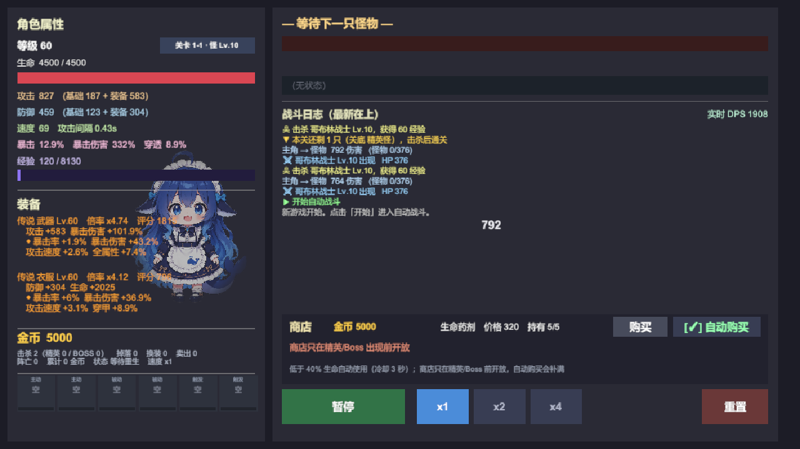
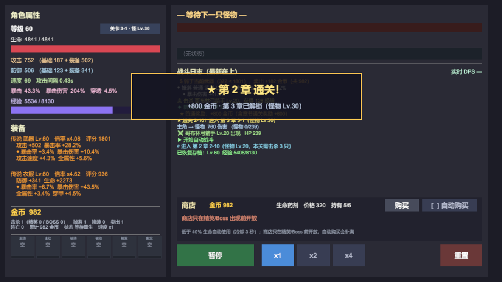

# Unity 自动战斗原型（AutoBattle）

一个用 Unity 做的挂机自动战斗小游戏。核心循环是：主角自动打怪 → 掉落装备 → 自动换装 → 升级加点 → 打更强的关。全部数值都在编辑器里可调、可热改，并有一整套平衡回归工具保证改数值不会悄悄跑偏。

项目的特殊之处在于：**它不是手写出来的，而是由 AI 编码代理（DeepSeek Harness）驱动 Unity 编辑器逐步搭建的**。开发过程留在了仓库里（`.mnemon/`），包括每一步的设计理由、踩过的坑和平衡实验数据。



## 玩法

- **自动战斗**：主角与怪物按各自的攻击间隔自动互殴，伤害公式为 `攻击 × 攻速 × (1 + 暴击率 × (暴击倍率 − 1))`，防御按 `护甲 / (护甲 + 系数 × 等级)` 减伤。
- **装备掉落与自动换装**：怪物掉落武器/护甲，按"增量期望 DPS + 有效生命/8"评分，高于身上那件就自动穿上，否则卖掉换金币。
- **技能三选一**：每次升级从随机三个候选里选一个装进技能槽（共 6 槽）。选哪个不是拍脑袋，而是让每个候选各打 15 场同关 Boss 后按胜场数择优。
- **关卡制**：11 章 × 10 关，第 N 章怪物 Lv.10(N−1)+1 ~ 10N（1-1 是 Lv.1 小鸡，11-10 是 Lv.110 BOSS），每关击杀 3~6 只，最后一只为关底精英或 BOSS。怪物等级不跟着主角走；怪物经验随等级线性抬高（`GameConfig.ChapterExpFactor`），保证主角等级能跟上章节。
- **巅峰等级**：满级后继续攒经验换巅峰等级，每级线性加成攻防与生命，是通关第 11 章的唯一途径。
- **多存档槽**：3 个互不影响的存档，进度、金币、装备、技能各自独立。

| 技能三选一 | 关卡选择 |
|---|---|
|  |  |

| 战斗可读性（飘字 / DPS / Buff 栏） | 章节通关 |
|---|---|
|  |  |

## 运行

1. 用 **Unity 6000.6.5f1** 打开 `HelloWorldProject/`（Universal 2D 模板）。
2. 打开 `Assets/Scenes/SampleScene.unity`。
3. 点 Play。场景里只有一个 `Bootstrap`，它在 `Awake` 里依次 `AddComponent` 出 `GameController` 和 `GameUI`，界面全部由代码构建，**没有任何 prefab 依赖**。

## 项目结构

```
HelloWorldProject/Assets/
├── Scripts/                 运行时（19 个文件，约 5950 行）
│   ├── Bootstrap.cs         入口：装配控制器与界面
│   ├── GameController.cs    主状态机 + 关卡推进 + 掉落结算（1084 行）
│   ├── GameUI.cs            UI 构建与左右面板（453 行）
│   ├── GameUI.Panels.cs     四个浮层面板：选关 / 技能 / 强化 / 存档（711 行）
│   ├── GameUI.Core.cs       刷新循环、控件工厂、飘字与 DPS（486 行）
│   ├── BattleSystem.cs      战斗结算与技能效果
│   ├── Models.cs            数据模型：MonsterData / Equipment / StageDef（384 行）
│   ├── Models.PlayerData.cs PlayerData：等级、关卡进度、技能槽、存档字段（394 行）
│   ├── Skills.cs            技能目录（15 个技能）
│   ├── SkillCatalog.Loader.cs 技能表的外部 JSON 加载与导出
│   ├── LootSystem.cs        掉落与词条随机
│   ├── EquipmentScore.cs    装备评分：增量期望 DPS
│   ├── Stages.cs            关卡目录与首通奖励公式
│   ├── SaveSystem.cs        存档（PlayerPrefs，当前 v6，按版本号迁移）
│   └── GameConfig*.cs       配置层：标量可热改，表结构需重编译
├── Editor/                  编辑器工具（5 个文件，约 2100 行）
│   ├── LateGameProbe.cs     平衡实验集合（胜率表、评分审计、权重搜索）
│   ├── BalanceRegression.cs 平衡回归：静态哨兵（含新档过渡轨迹）+ 胜率表
│   ├── NewGameProgression.cs 新档进度探针：Lv.1 空身从 1-1 打到终点
│   ├── SkillTableVerify.cs  skills.json 与代码表的对照自检
│   └── GameConfigReloader.cs 菜单：重读 game_config.json
├── Resources/
│   ├── game_config.json     可热改的标量配置（缺键会在加载时打警告）
│   ├── skills.json          15 个技能的数值表
│   └── HeroPortrait*.png    主角立绘
├── Screenshots/             开发过程截图（README 引用的那几张）
└── Scenes/SampleScene.unity
```

仓库根目录还有几个不属于 Unity 工程的资产：

- `_balance/` —— 平衡回归基线（`baseline.json`）、探针说明（`README.md`）与冒烟截图（`shots/`），放在工程外以免被 Unity 导入。
- `_art/` —— 立绘素材、生成提示词与图像处理脚本。
- `.mnemon/` —— 项目知识库与热记忆，跨会话接手时从这里读。
- `_archive/` —— 归档区（已 gitignore）：`legacy/` 是拆分前的旧版 `GameController.cs`/`GameUI.cs` 与文件头备份，`screenshots/` 是早期开发截图。不进 Unity 工程，也不会被导入。
- `dsh-image-gen/` —— 生图插件的输出目录（已 gitignore）。

## 配置热改

`Assets/Resources/game_config.json` 里的**标量**（数值系数、倍率、开关）在游戏运行时改完即生效，不需要重编译；`GameConfig.Tables.cs` 里的**数组表**（技能表、章节怪物名、属性偏向等）是编译期常量，改 JSON 无效。两处的边界在 `GameConfig.Tables.cs` 头部有注释说明。

## 平衡回归

改数值之后跑一遍，能立刻看出是否把某档平衡打歪了：

- 菜单 **Tools/平衡回归/** → 静态哨兵（技能表、公式采样、关卡表、怪物样本、评分自洽性，外加新档过渡轨迹，约 1.2 秒；前五张表逐字符比对，过渡轨迹按容差比对）
- 胜率表（8 个巅峰档 × 4 个难度格，约 25 秒，容差 0.5 个百分点）

设计要点：战斗随机全部走 `UnityEngine.Random`，用 `Random.InitState` 固定种子让整轮模拟逐位可复现；每个巅峰档用独立种子，这样改动能定位到具体某一档。基线存在 `_balance/baseline.json`。

`NewGameProgression.cs` 补的是另一类问题：**新档能不能玩**。它从 `new PlayerData()`（Lv.1、空身、无金币）起步，逐关模拟"打小怪→回满血打关底"，死了重试，直到通关或卡住，输出每章末等级/阵亡数/耗时。菜单 **Tools/测试/新档进度探针（从头打到底）**，或命令行跑 `AutoBattle.EditorTools.NewGameProgression.Run(seed, maxAttemptsPerStage, verbose)`。改动关卡强度、经验曲线、掉落权重后都该跑一遍。

它同时是回归门禁的一部分：逐章轨迹（章末等级/尝试/阵亡/耗时）写进 `_balance/baseline.json` 的 `transition` 小节，静态哨兵每次都会比对；另外 `CheckInvariants()` 有无需基线的硬约束——不卡死、每章末等级不低于下一章怪级下限、终局 Lv.≥95、阵亡 ≤60 次。整轮模拟只要 20 毫秒左右，所以挂在毫秒级门禁上不心疼。

`LateGameProbe.cs` 则是开发和探索阶段留下的一批实验入口（`RunWinrate` / `ScoreAudit` / `ScoreWeightSearch` / `ComboAudit` / `SurvivalAudit` 等），部分结论已经过时，但保留了当时的实验数据，读的时候注意看注释里的日期与结论。

## 开发进度

原始规划 12 步，已完成 6 步：

| 阶段 | 步骤 | 状态 |
|---|---|---|
| P0 工程基础 | 1 配置外部化 | ✅ |
| P1 核心循环 | 2 装备强化（+1~+15） | ⬜ |
| | 3 装备洗练（重铸副词条） | ⬜ |
| | 4 关卡/章节推进 | ✅ |
| | 5 技能三选一 | ✅ |
| P2 战斗可读性 | 6 Buff/Debuff 图标栏 | ✅ |
| | 7 伤害飘字 | ✅ |
| | 8 实时 DPS 面板 | ✅ |
| P3 长线目标 | 9 成就系统 | ⬜ |
| | 10 转生（重置等级换永久加成） | ⬜ |
| | 11 无尽模式 + 最高层记录 | ⬜ |
| P4 表现层 | 12 音效 / 2D 精灵 / 技能特效 | ⬜ |

另外已完成但不在原计划里的：护甲穿透属性、装备评分改口径、多存档槽、平衡回归工具、主角立绘。

## 已知问题

- **技能表没有外置**：15 个技能的倍率/冷却/持续硬编码在 `Skills.cs`，改数值要重编译。配置外部化那一版漏了它。
- **中间章节配装平衡只做了近似验证**：`LateGameProbe` 用"该章预期等级 + 随机精英装备"造人，`NewGameProgression` 从 Lv.1 空身一路打到 11-10（两者都见 `_balance/README.md`）。但两个探针都不模拟技能三选一与手动换装，第 11 章主要靠阵亡给的部分经验"磨"过去——真机手感仍建议定期跑一遍新档。
- **`GameUI` / `PlayerData` 偏胖**：分别是 1368 行和多个职责混在一起，重构风险高，计划等玩法稳定后再动。
- **`HandleMonsterKilled()` 182 行**未拆。
- **终局 11-10 通关后每杀一只仍走一次通关结算**：最后一关 `AdvanceStage()` 返回 false、`stageKillCount` 不归零，于是 `IsStageCleared` 一直为真——每只怪都会多等 3 秒（`StageClearDelay`）并刷一条「★ 通关 11-10！已经是最后一关」。金币不重复发（首通标记挡着），属于小瑕疵，未修。
- **界面每帧全量刷新**：`GameUI.Update` 每帧无条件 `Refresh()`（约 30 条字符串/帧），装备评分与 DPS 也每帧重算。1280×720 下没掉帧，但 GC 压力偏大，属于以后再优化。
- **日志/飘字两条写入路径**：战斗伤害行由 `BattleSystem` 直接 `Log.Add`（不走 `GameController.AddLog`），累计条数在 `GameController.TickFighting` 里补记。**以后再往 `Log` 里加新写入点时，必须同步 `TotalLogEntries`/`LogVersion`**，否则飘字与实时 DPS 会静默停摆（2026-10 踩过一次）。

## 关于立绘

主角是"蓝色鲸鱼娘"——DeepSeek 的拟人化同人形象。当前立绘由 `dsh-image-gen` 插件走火山方舟 Seedream 生成（开启 `seedreamBackground: transparent` 直接得到透明底，无需抠图），提示词与参考图在 `_art/`。早期尝试过从 CC0 素材库挑图和用 Pillow 代码手绘，两条路都已废弃。

## 开发环境备注

这台机器上驱动 Unity 用的是 `unity-cli`，几个容易踩的点：

- 判断编辑器死活看 `unity status` 的 `state` 是否为 `ready`，不要信 `unity pipeline list` 的 `isRunning`。
- Edit 模式下改写 `.cs` 后，**Play 模式下 `AssetDatabase.Refresh` 不一定会重编译**；验证新改动必须先 `editor_stop` 再 Refresh，再重新 Play。
- 落盘判据是 `console_status` 的 `compilationFailed` 与 `consoleErrors`，不是 `recompile` 的 `up_to_date`。
- 电脑锁屏时启动 Unity 必崩（拿不到图形上下文），崩溃后要清掉 `Temp/UnityLockfile` 再开。
- `git` 装在这台机器的 `D:\Program Files\Git`；访问 GitHub 需要 `http.sslBackend=schannel`（该网络环境的证书链有问题）。
