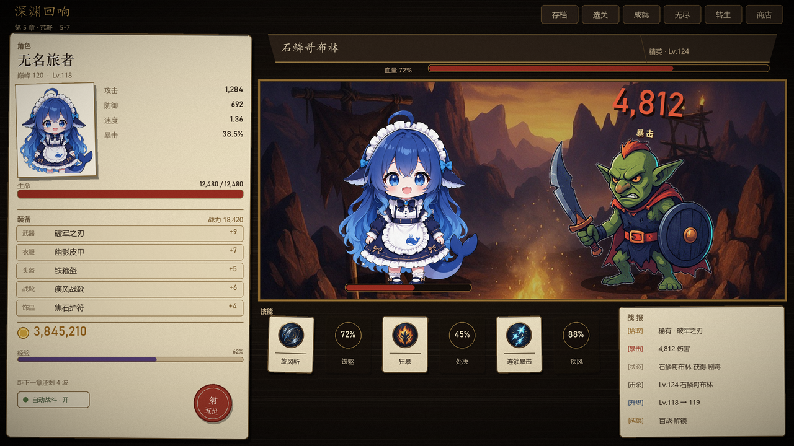
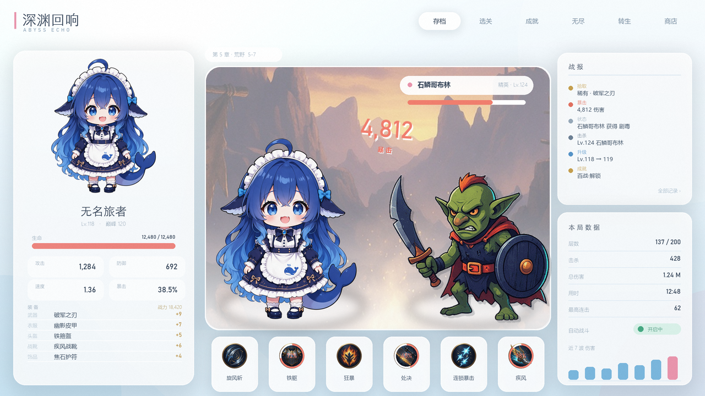

# UI 视觉方向参考（调研稿，2026-10-27；只列方向，未改任何代码）

- **状态**：调研 / 待选定方向
- **关联**：`GameUI.Theme.cs`、`GameConfig.Colors.cs`、`GameUI.Factory.cs`、`GameUI.cs:288-292`
- **结论先说**：现在的 UI 不是「配色选错了」，是**缺了三样东西——字体、材质、动效**；同时色板为了同时讨好「暗黑怪物」和「蓝色鲸鱼娘」取了折中，结果两头都不站。下面 6 个方向，任意一个配上 §3 的三件横切改造，都会比现在好看一个档次。

## 1. 为什么现在不够好看（有据可查的 5 条）

| # | 问题 | 证据 |
|---|---|---|
| 1 | **没有字体资产**，标题/正文/数字全是 Unity 内置 LegacyRuntime（回退 Arial），只靠 11/13/15/18/22 五档字号区分层级 | `GameUI.cs:288-292`；工程里 0 个 .ttf/.otf |
| 2 | **只有一种形状语言**：所有面板、卡片、按钮都是程序化圆角矩形 + 1.5px 描边，没有纹理、没有内阴影、没有高光 | `GameUI.Theme.cs:33` RoundSprite、`:85` RingSprite、`CreateCard` 被 30 处调用 |
| 3 | **色阶压得太扁**：PanelBg (0.075,0.086,0.118) → CardBg (0.094,0.110,0.153) → RowBg (0.106,0.125,0.173)，相邻层只差 0.02 明度；强调蓝和「信息蓝」也几乎同色 | `GameConfig.Colors.cs` |
| 4 | **几乎没有动效**：全工程只有战斗突刺（`GameUI.Stage.Frame.cs:113`）和 DPS 平滑（`GameUI.Fx.cs:163`）两处 Lerp，没有 hover / press / 入场 / 数字滚动 | grep 结果 |
| 5 | **布局是绝对坐标固定卡片**（1280×720，Expand 缩放），每块都塞满，没有留白节奏与视觉焦点 | `GameUI.cs:320` |

一句话：现在是「深蓝底 + 圆角 + 白字」的默认网页后台感，而不是一个游戏该有的样子。

## 2. 六个方向

### 方向 A｜暗金浮雕（史诗暗黑）

- **视觉语言**：金属九宫格边框 + 雕花角饰；面板内阴影 + 顶部 1px 高光；暖金强调色压在冷暗底上；暗角 vignette；按钮像铜牌压印。
- **参考**：Diablo IV、Hades（Pact of Punishment 面板）、Path of Exile 物品框。
- **与现有契合**：怪物/背景都是暗色 AI 立绘，这个方向能把它们统一；但和蓝色鲸鱼娘的浅色二次元感冲突。
- **成本**：**L**——需要 10~15 个九宫格美术资产（边框、角饰、按钮、页签），是唯一必须买或 AI 生成 + 手修的方向；代码侧只是换 sprite 和色板，不难。
- **风险**：九宫格不能靠 AI 一键生成（拉伸会糊），得找现成 UI 包（Kenney 的 fantasy 包偏卡通风，需要更精致的商业包）。

### 方向 B｜实体卡牌 / 桌面（Balatro · 杀戮尖塔 · Inscryption）

- **视觉语言**：卡片有实体感——纸纹噪点、硬投影（偏移 2~3px、不模糊）、轻微随机旋转 ±1.5°、按下时下沉；标题用有笔锋的字体或印章；按钮做成压印/贴纸。
- **参考**：Balatro（CRT + 抖动 + 卡牌扭动）、Slay the Spire（石雕边框 + 高对比手绘）、Inscryption（桌游木桌感）。
- **与现有契合**：**最高**。三选一/遗物/契约/符文这些即将上线的系统全是卡牌语法；现有 30 处 CreateCard 可以原地升级。
- **成本**：**M**——程序化就能做出 70%（噪点贴图 + 阴影偏移 + 旋转 + 字体），不需要大量美术资产。
- **风险**：卡牌语法会让人以为这是卡牌游戏，需要靠 HUD（血条/数字区）保持「战斗」的即时感。

### 方向 C｜水色日系轻小说（Blue Archive · 明日方舟）

- **视觉语言**：半透明白/浅蓝面板 + 细线 + 大量留白；标题大字用细黑或宋体、字距拉开；角色立绘「溢出」框架边缘；底部斜切条；弱化描边、靠明度分层。
- **参考**：Blue Archive（NGA 有玩家整理的 UI 设计建议书）、明日方舟。
- **与现有契合**：和蓝色鲸鱼娘最搭，也最像「商业手游」；但 11 章暗黑怪物立绘放进浅色面板里会像贴纸。
- **成本**：**M~L**——真正的 BA 感依赖「背景模糊 + 毛玻璃」，UGUI 做实时模糊要抓屏 + blur shader（性能与实现成本都高），通常用静态渐变 + 低对比图代替。
- **风险**：全局色板翻转（暗→亮），所有 85 个图标的亮色/暗色适配要复查一遍。

### 方向 D｜高清像素 + CRT（Loop Hero · Vampire Survivors · Brotato）

- **视觉语言**：像素字体（中文用 Cubic 11）、硬边无抗锯齿、2px 描边、扫描线/色差、抖动（dither）渐变；数字用像素等宽。
- **参考**：Loop Hero（像素 + 卡牌）、Vampire Survivors、Brotato。
- **与现有契合**：低——现有立绘是 803×1024 的 AI 高清图，像素化会立刻变丑；要全盘换图就是 L 以上。
- **成本**：HUD 层 **S**，全盘 **L**。
- **折中玩法**：只把 **HUD/图标/边框** 像素化、角色与背景保持高清（近似 HD-2D 的混搭），成本 M，风格独特但风险也独特。

### 方向 E｜数据终端（Melvor Idle · Antimatter Dimensions）

- **视觉语言**：极简底 + 等宽数字 + 网格线 + 纯文字表格；没有装饰、只有排版层级；大数字用 tabular 对齐。
- **参考**：Melvor Idle（wiki 式布局）、Antimatter Dimensions。
- **与现有契合**：和「挂机看数字」最搭，也最快；但「好看」上限低，用户现在抱怨的很可能正是「太平」。
- **成本**：**S**——纯代码 + 一套字体，不用美术。

### 方向 F｜木刻版画（Darkest Dungeon · Griftlands）

- **视觉语言**：高对比黑白 + 单一血红；粗糙笔触边框、衬线字体、颗粒纹理、悲剧感留白。
- **与现有契合**：暗黑怪物合适，但整体变单色，和 11 章彩色背景冲突。
- **成本**：**M~L**（需要版画风格边框资产）。

## 3. 不管选哪个方向，都该先做的三件横切改造（性价比最高）

| # | 改造 | 具体做法 | 成本 | 预期效果 |
|---|---|---|---|---|
| 1 | **换字体** | 正文/UI 用思源黑体或未来荧黑；大标题用得意黑（有笔锋）；数字用等宽数字（tabular）。当前 5 档字号不变，只换字型。 | S（半天） | 单这一项就能去掉 40% 的「网页后台感」 |
| 2 | **加材质与光** | 全局 12% 噪点 overlay；面板内阴影 + 顶部 1px 高光；屏幕四角暗角；卡片描边改成「上亮下暗」两段式。 | S~M（1~2 天） | 从「平色块」变成「有厚度的板子」 |
| 3 | **动效与反馈** | 按钮 hover 提亮 8% / press 下沉 2px；面板入场 0.15s ease-out 缩放；数字滚动（每帧逼近）；暴击时卡面抖 0.2s。 | S~M（1~2 天） | 「贵」的手感 80% 来自反馈速度 |

这三件事与方向无关，可以独立先做——即使方向还没定，也不浪费。

## 4. 一个容易被忽略的适配问题

现在的主角是**浅色水感的蓝色鲸鱼娘**，怪物是**暗色 AI 立绘**，背景是**4 张照片感 JPG**。色板当初选「深蓝」是想两头兼顾，结果：深蓝既压不住暗黑怪物（不够黑金），也衬不出鲸鱼娘（不够亮）。

所以选方向时其实是在选**站在哪一边**：

- 站怪物 → A（暗金）或 F（木刻），鲸鱼娘加描边/调色融入；
- 站主角 → C（水色），怪物统一加轮廓光与压暗；
- 都不站 → B（卡牌），用「桌面 + 卡牌 + 立绘」的中性框架让两者共存，这也是我推荐 B 的结构性原因。

## 5. 我的建议（如果需要我选）

1. **主线：B（卡牌实体感）+ §3 三件套**。理由：成本 M、程序化可做、和即将上线的遗物/契约/符文/三选一完全同构；将来想换 A/C，卡片层不用重做。
2. 如果更想要「二次元商业手游」的观感：**C**，但先只改左侧面板（立绘区 + 状态区）试水，别全局翻。
3. **A 不建议现在做**：它需要成套九宫格美术资产，是唯一会卡在「没有美术」上的方向。
4. **D 只做 HUD 层**可以当调色试验，不要全盘像素化（会毁掉现有立绘）。

## 6. 参考资源

**UI 截图库（最重要，直接能刷）**
- Game UI Database：<https://www.gameuidatabase.com/> —— 55,000+ 张游戏 UI 截图，可按游戏/界面元素筛选（报道：<https://www.gamedeveloper.com/design/game-ui-database-relaunches-with-new-features-video-support-and-over-55-000-screenshots>）
- Interface In Game：<https://interfaceingame.com/> —— 300+ 款游戏，带录屏

**设计分析**
- Slay the Spire 的 UI 为什么耐看：<https://www.cloudfallstudios.com/blog/2018/2/20/flash-thoughts-slay-the-spires-ui>
- Balatro 视觉拆解（卡牌、CRT、抖动）：<https://www.artstation.com/blogs/retrostyle-games1/PQMKA/balatro-game-art-style-a-complete-visual-breakdown>
- 蓝色档案 UI 设计建议书（中文，逐元素拆）：<https://ngabbs.com/read.php?tid=42867771>

**免费资源（真要动手时用）**
- Kenney UI Pack（CC0，可直接商用）：<https://kenney.nl/assets/ui-pack>、<https://kenney.nl/assets/ui-pack-adventure>
- itch.io 免费 UI 资产：<https://itch.io/game-assets/free/tag-ui>
- 得意黑（OFL，标题字）：<https://github.com/atelier-anchor/smiley-sans>
- Cubic 11 像素中文字（OFL）：<https://github.com/ACh-K/Cubic-11>
- 思源黑体：<https://github.com/adobe-fonts/source-han-sans>

## 7. 下一步（等你点头）

1. 你挑 1~2 个方向（或只挑 §3 的三件套）。
2. 我先出 **3 张静态 mockup**（不改代码，用现有真实数据排版，纯看风格）。
3. 定稿后再动 `GameConfig.Colors.cs`（色板）与 `GameUI.Theme.cs`（形状/材质），一步一屏，避免一次性全局改崩。
## 8. Mockup 两张（2026-10-27，用真实数据与真实资产排版）

> 图在 `docs/images/`，脚本在 `_art/ui-mockup/`（Pillow 程序化渲染，2× 超采样）。两张都用工程现有资产：`HeroPortrait.png`、`goblin_melee.png`、`bg_wilds.jpg`、`Icons/*`；文字取真实数值（Lv.118 / 巅峰 120 / 3,845,210 金币 / 第 5 章 5-7）。

### B · 实体卡牌桌面

- **语言**：深木桌面 + 羊皮纸 + 硬投影（偏移 4,7、不模糊）+ 卡片 ±1.5° 随机旋转 + 红色蜡封印章。
- **布局**：左侧「角色卡」整张做成羊皮纸（相框 / 生命 / 装备 / 金币 / 经验 / 蜡封），右侧战斗区做成**画框**（3px 金边 + 背景压暗 0.78），底部 6 张技能小卡各自歪一点、冷却用压暗圆盘，右下战报纸条。
- **为什么值得选**：不需要任何新美术资产——噪点、硬阴影、旋转、撕边都能程序化；现有 85 个图标可直接当卡面，30 处 `CreateCard` 原地升级。
- **风险**：卡牌语法偏「桌游」，HUD 的血条/伤害数字要保留即时感来对冲。

### C · 水色轻小说

- **语言**：天光渐变底（#F5FBFE → #D3E8F5）+ 白色 210α 圆角面板 + 柔光投影；标题细黑拉开字距，数字用 Bahnschrift 细体，强调色珊瑚粉/水蓝。
- **布局**：左角色面板（立绘 / 生命条 / 2×2 属性块 / 装备行），中间**无边框雾化舞台**（背景图与白混合 48%，底部白渐变收边），右上战报卡、右下本局数据 + 迷你柱状图，底部 6 张技能卡用弧线表示冷却。
- **代价**：这个方向的上限取决于毛玻璃（抓屏 + 双向模糊），Unity UI 里做真毛玻璃成本高于 B；不追求真毛玻璃的话程序化近似也能出八成。
- **风险**：浅底上文字对比度必须重调，暗色怪物立绘需要描边/暗角过渡。

### 两张对照

| | B 卡牌 | C 水色 |
|---|---|---|
| 与现有资产契合 | 高（图标=卡面） | 中高（立绘=主角） |
| 新增美术资产 | 0 | 0（毛玻璃可近似） |
| 代码改动面 | `GameUI.Theme.cs` + `CreateCard` 升级 | 面板层级、背景光晕、对比度整体重调 |
| 与遗物/契约/三选一 | 天然同构，同一套卡面 | 要另做一套卡面 |
| 观感风险 | 像卡牌游戏 | 亮色疲劳、对比度不足 |

### 下一步

1. 挑一张（或「B 的骨架 + C 的配色」这种混搭）。
2. 定稿后先在**一个面板**上落地（建议左角色面板），验证字体与九宫格在真机 1280×720 下的观感。
3. 再逐屏推广到存档/选关/技能面板，避免一次性全局改崩。